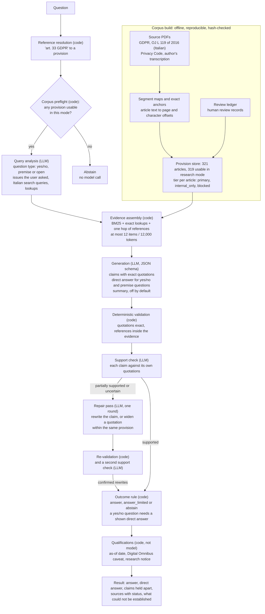

# Legal Research RAG

A question-answering prototype for Italian data-protection law (the GDPR and the Italian Privacy
Code) in which every statement quotes the provision it rests on, and the system says what it
could not establish.

- **Live demo:** [legal-rag-live.onrender.com](https://legal-rag-live.onrender.com). Ask your
  own question. It is limited (3 questions per visitor per hour, 10 per day), and on free hosting
  it may take about a minute to wake up. Questions are sent to Anthropic's API.
- **Replay:** [huggingface.co/spaces/SimoneZanetti00/legal-rag-demo](https://huggingface.co/spaces/SimoneZanetti00/legal-rag-demo).
  Saved answers to the benchmark's 12 dev questions, with no model calls.

**Three questions to try on the live demo:**
1. Is it true that every company with more than 250 employees must appoint a DPO?
2. Qual è l'età minima per il consenso del minore ai servizi della società dell'informazione in
   Italia?
3. Il GDPR prevede un termine di 96 ore per notificare una violazione dei dati personali?

**What to look at in an answer:**
- **The direct answer** to a yes/no question. It is shown only if every statement it rests on is
  confirmed, and those statements are marked «basis».
- **The exact quotations.** Each statement ends with the provision it rests on; open it to see
  the quotation, checked character by character against the source.
- **Statements held apart.** What the support check did not confirm is shown separately, not as
  part of the answer.
- **Widened quotations.** Where the repair pass widened a quotation within the same provision, to
  include a condition, the quotation is marked, with its original.
- **The source status.** Each provision says what kind of text it is and that no person has
  reviewed it yet.

> **Not legal advice.** This is a research and software-engineering prototype. Its output must
> not be relied on as a legal opinion.

## What it does

A saved answer to benchmark question a24, from run `2026-11-26-direct-answer` (research mode).
It is shortened here: «[…]» marks text left out, and in the answer every quotation is complete.

```text
question: Is it true that every company with more than 250 employees must appoint a DPO?
outcome: ANSWER                                   as of: 2026-11-26

direct answer: NO (an interpretation of the statements it rests on: C1, C2, C3, C4)
    No: the obligation depends on the conditions in Article 37(1), not on having more than
    250 employees.

C1 (source statement; support: supported) Article 37(1) requires designation of a DPO in
   three cases: processing by a public authority or body; […]
   E1: «il trattamento è effettuato da un'autorità pubblica o da un organismo pubblico, […]»
   ... (two more quotations of Art. 37(1); C2, also on Art. 37(1))
C3 (source statement; support: supported; repaired) In cases other than those in paragraph 1,
   the controller, the processor or […] may designate a data protection officer, or must do so
   if Union or Member State law provides for it.
   E1: «Nei casi diversi da quelli di cui al paragrafo 1, […] possono o, se previsto dal diritto
        dell'Unione o degli Stati membri, devono designare un responsabile della protezione dei
        dati.»
        widened by the repair pass from: «possono o, se previsto dal diritto dell'Unione o
        degli Stati membri, devono designare un responsabile della protezione dei dati.»
C4 (source statement; support: supported; repaired) Article 30(5), on records of processing
   activities, provides that the obligations in paragraphs 1 and 2 do not apply to businesses
   or organisations with fewer than 250 employees, unless the processing is likely to risk the
   rights and freedoms of the data subject, is not occasional, or includes special categories
   of data […]
   E4: «Gli obblighi di cui ai paragrafi 1 e 2 non si applicano alle imprese o organizzazioni
        con meno di 250 dipendenti, a meno che il trattamento che esse effettuano possa
        presentare un rischio per i diritti e le libertà dell'interessato, […]»
        widened by the repair pass from: «Gli obblighi di cui ai paragrafi 1 e 2 non si
        applicano alle imprese o organizzazioni con meno di 250 dipendenti»

citations: [E1] GDPR Art. 37, [E4] GDPR Art. 30: 2016 original publication, pending human review
qualifications: research-mode notice · validity not established · the support check is a
  model's assessment · 11 candidate provisions left out by the evidence limits · as-of date
```

The model writes the claims and the direct answer. The code decides the rest:
- which claims stay in the answer, and the outcome;
- whether the direct answer is shown: only if every claim it rests on is supported;
- whether a widened quotation is accepted: an exact passage of the same provision that contains
  the original;
- the source status and the qualifications.

## How it evolved

Each step is a single run, so model variance is not measured. Details:
[docs/evaluation/answers-v0-results.md](docs/evaluation/answers-v0-results.md).

1. **Baseline** (2026-11-17): evidence limited to 5 items / 3,000 tokens; 76% of the core
   provisions reached the model; outcomes 3/22.
2. **T6, evidence selection:** 12 items / 12,000 tokens; core provisions in the evidence 97%;
   outcomes 8/22.
3. **T7, query analysis:** only the issues the user asked (1–2 instead of 4–8); 17/22 under the
   adopted outcome rule. A rule that scored 22/22 was rejected because it ignored the model's
   report of a partial answer.
4. **Final configuration** (2026-11-17): claims quote every element they list and are rated
   against their own quotations; 18/22, and core citation recall 91% by design (33 claims held
   apart).
5. **Repair pass** (2026-11-24, the 12 dev questions): one rewrite round; held-apart claims 16 to
   8, outcomes unchanged (10/12).
6. **Live test** (2026-11-25): answers on the live demo showed yes/no questions answered without
   an explicit yes or no (TD-069), and quotations that stopped before their condition (TD-070).
   Three of its questions became the candidates a23–a25.
7. **M2, widening a quotation** (2026-11-26, 25 questions): held-apart claims 26 to 15, outcomes
   unchanged (21/25). The cap on the added text was raised from 300 to 350 characters after the
   results.
8. **M1, direct answers** (2026-11-26): question type classified as expected on 25/25; direct
   answer shown and correct on 6 of the 7 yes/no questions. The outcome change (21 to 22/25) is
   not M1's effect: M1 changed only a20, for the worse (TD-072).
9. **Live re-test** (2026-11-27): the deployed M2 and M1, re-tested on the live demo by the owner.
   Its findings are not recorded in this repository yet.

## The problem

A legal answer is only useful if a professional can check it quickly. Language models write
fluent answers, but they also cite provisions that do not exist and quote text that is not in
the source. They also state as settled what the source says only in part.

The sources differ in reliability too: an official publication, an unofficial transcription and
a text nobody has reviewed should not be cited in the same way.

This project treats those problems as engineering constraints. The code enforces what can be
checked deterministically: exact quotations, references inside the evidence, and which sources
may be cited. A model assesses only what cannot be checked that way, and the answer says it was
a model's assessment.

## Run it locally

| What | Command | Needs |
|---|---|---|
| **Replay of saved answers** (12 dev questions, from the M1 run, no model call) | `.\.venv\Scripts\python.exe -m http.server --bind 127.0.0.1 --directory demo\replay 8001`, then open http://127.0.0.1:8001/ | Python only |
| Live web demo | `.\.venv\Scripts\python.exe -m src.web_demo` | An Anthropic API key (the corpus build is in the repository) |
| Offline pipeline demo | `.\.venv\Scripts\python.exe -m src.demo` | Nothing (synthetic act, scripted model replies) |
| Tests | `.\.venv\Scripts\python.exe -m pytest` | Nothing (offline; tests needing the local build are skipped without it) |

The replay is a static site and can be hosted anywhere: see
[docs/deploy-replay.md](docs/deploy-replay.md). Setup and every command:
[docs/REFERENCE.md](docs/REFERENCE.md).

## Architecture



- **Modes** are evidence policies over one pipeline. Verified mode uses only provisions with a
  recorded human review; research mode also uses those pending review, each marked.
- **Model client:** one client (`src/llm.py`) serves every model step. It returns structured
  JSON, retries once on a malformed reply, and records token usage.
- **Benchmark model:** `claude-sonnet-5-5`.
- **Main modules:** `answer_generation.py` (pipeline, outcome rule), `evidence.py`,
  `query_analysis.py`, `support_verification.py`, `source_status.py`, `web_demo.py` and
  `web_replay.py`, all in `src/`.

## Guarantees

**Enforced by code, on every answer:**
- **Exact quotations.** A claim must quote the evidence it cites exactly, after a documented
  normalisation of whitespace, layout markers and soft hyphens. Otherwise it is removed.
- **References inside the evidence.** Every article a claim names must be a cited provision, or
  one the cited text names. Otherwise the claim is removed.
- **A citation gate.** Only provisions of the mode's tiers become evidence. In verified mode,
  with no human review recorded, a question abstains before any model call.
- **Claims held apart.** A claim the support check did not rate SUPPORTED is shown separately
  and is not part of the answer.
- **One repair round.** The model rewrites each held-apart claim once, to state only what its own
  quotations state. It may also widen a quotation within the same provision to include a
  condition: the widened text must be an exact passage of that provision, contain the original
  quotation and add at most 350 characters. The rewrite is re-validated by the same checks and
  re-checked for support; only a confirmed rewrite enters the answer, marked as repaired.
- **Direct answers.** A yes/no question's direct answer is shown only if every claim it rests on
  is SUPPORTED and in the answer, and its text names no provision outside them.
- **An outcome rule.** The outcome is `answer` only if every issue has a SUPPORTED claim, the
  model reported none as only partly answered and, for a yes/no question, the direct answer is
  shown. Otherwise it is `answer_limited`.
- **Source status.** Each source states separately: official or unofficial transcription;
  compared with an official text or not; reviewed by a person or not; legal currency not
  established; citable or not.
- **Fixed qualifications.** Every answer carries its as-of date and a notice that legal
  validity is not established. GDPR Art. 33 answers add the Digital Omnibus caveat; research
  mode puts its notice first.

**Assessed by a model, not guaranteed:**
- whether a claim's quotations state everything it says (the support check);
- the issues a question raises, its type (yes/no, premise or open), and what to search for;
- the wording of a direct answer: it is an interpretation of its claims and is not
  support-checked itself.

**Not established at all:** whether any provision is valid, in force or applicable at any date.
The GDPR text is the 2016 original publication; the Privacy Code text is an unofficial
transcription supplied by the author.

## Evaluation

**The benchmark, `answers-v0`:**
- 25 questions in Italian and English: 12 dev, 10 test, and 3 candidates (a23–a25) taken from
  the live demo. Two of them must abstain.
- Each question has an expected outcome and the "core" provisions an answer needs.
- Scoring is deterministic and offline, stage by stage: are the core provisions among the
  candidates, in the evidence given to the model, and cited in the main answer?
- Every model reply is saved with hashes of its prompt, message and schema, so a later change
  is re-measured on the same replies, offline.

The figures use the expectations as drafted: **candidate expectations, not owner-reviewed**.
All runs are in research mode. Details:
[docs/evaluation/answers-v0-results.md](docs/evaluation/answers-v0-results.md).

| | Baseline | T6: evidence selection | T7: query analysis | Final |
|---|---|---|---|---|
| Evidence limits | 5 items / 3,000 tokens | 12 / 12,000 | 12 / 12,000 | 12 / 12,000 |
| Issues per question | 4–8 | 4–8 | 1–2 | 1–2 |
| Core provisions among the candidates | 100% | 100% | 100% | 100% |
| … in the evidence given to the model | 76% | 97% | 99% | 99% |
| … cited in the main answer | 81% | 95% | 98% | **91%** |
| Outcome matches | 3/22 | 8/22 | 9/22 | **18/22** |
| Claims in the answer / held apart | 175 / 10 | 200 / 10 | 121 / 13 | 105 / 33 |

1. **Retrieval was not the bottleneck.** Every core provision was among the candidates in every
   run. A comparison of BM25, hybrid and reranked retrieval could not move this benchmark, so
   it was dropped.
2. **Evidence selection was the bottleneck.** At 5 items and 3,000 tokens, fifteen core
   provisions never reached the model. T6 raised the limits and kept looked-up articles whole,
   merging matched spans otherwise. It also stopped lookups from crowding out search hits.
   Result: 76% to 97%.
3. **The outcome gap came from query analysis.** The analysis split questions into 4–8 issues,
   including topics nobody asked about, and the model then reported them unanswered. T7 limited
   the issues to what was asked.
4. **A rule that scored 22/22 was rejected.** That version of the outcome rule ignored the
   model's own report that an issue was only partly answered. The adopted rule keeps the report:
   17/22 on the same saved answers, re-scored offline.
5. **The final configuration** makes claims quote every element they list, rates each claim
   against its own quotations, and looks up Code Art. 2-bis when a question names the Garante
   or Italy. Result: 18/22.

**Citation recall fell from 98% to 91% by design.** This is a precision trade-off from the
stricter support check:
- A claim that states more than its own quotations cover is now held apart: still visible, but
  not part of the answer.
- Held-apart claims rose from 13 to 33. Evidence recall did not change.
- Citation recall fell only where the sole claims citing a core provision were held apart: a06
  (86% to 71%), a07 (78% to 56%) and a18 (100% to 0%; its expected outcome is `answer_limited`
  anyway).

In a legal answer, a statement that says more than its source is the failure that matters most.

**A repair pass recovers held-apart claims.** On the 12 dev questions (2026-11-24), one repair
round put 10 rewritten claims into the answer, and held-apart claims fell from 16 to 8. Citation
recall rose from 93% to 97%; outcomes were unchanged (10/12). The run cost $0.09, because only the
repair calls and their support checks were new.

The four remaining mismatches (a06, a07, a15, a22) are `answer_limited` where `answer` was
expected. In each, the model reported its question as only partly answered; a06 and a07 are
broad overview questions.

**Two changes from the live demo (2026-11-26).** Answers on the live demo showed two problems.
Three of its questions became the candidates a23–a25.
- **M2, widening a quotation (TD-070).** A claim whose quotation stopped before its condition was
  held apart, although the provision states the condition. The repair pass may now widen the
  quotation within the same provision. The widened passage must be exact, contain the original,
  and add at most 350 characters; the support check then runs again.
- **M1, direct answers (TD-069).** A yes/no question could be answered without an explicit yes
  or no. Now it gets a direct answer, as an interpretation of the claims it rests on. It is shown
  only if they are all supported; without one shown, the answer is `answer_limited`.

| On 25 questions | Repair v1 | M2: widening | M1: direct answers |
|---|---|---|---|
| Claims in the answer / held apart | 132 / 26 | 144 / 15 | 140 / 6 |
| Core provisions cited in the main answer | 98% | 99% | 98% |
| Outcome matches | 21/25 | 21/25 | 22/25 |
| Question type classified as expected | — | — | 25/25 |
| Yes/no questions with the expected direct answer shown | — | — | 6/7 |

- **Each column is a single run.** Model variance is not measured.
- **M2's 300-character cap was raised to 350 after the results,** on the Art. 30(5) exception; a07
  and a24 were run again, and the M1 column compares with that (144 / 16).
- **What is M1's own effect:** the classification and the direct answers.
  - The outcome change is not M1's: M1 changed only a20, for the worse. Its direct answer was
    withheld because one of its four basis claims was not confirmed (TD-072).
  - a01, a06, a15 and a22 are open questions; their changes are run-to-run variation.
  - Every call was made again in the M1 run, so the fall in held-apart claims cannot be
    separated from that variation either.

**Cost and variance.** Costs come from the API's reported token usage, under a budget guard that
stops a run before it can exceed its limit.

| Run | Questions | Live calls | Cost |
|---|---|---|---|
| Final run (2026-11-17) | 22 | generation and support check | $1.08 |
| M2 baseline (2026-11-26) | 25 | repair calls on a13–a22; a23–a25 fully | $0.284 |
| M2, widening | 25 | repair calls and their support checks only | $0.416 |
| M2, cap re-run | 2 (a07, a24) | as M2 | $0.063 |
| M1, direct answers | 25 | every call | $1.702 |

Each is a single run, so model variance is not measured.

**Owner-reviewed scope.** The owner reviewed a01–a13 and their rows on 2026-11-18, with a
second opinion from an AI assistant on each row; the decisions are the owner's. On those 13
questions, the final run scores core recall 100% / 98% / 94% (candidates / evidence /
citations) and **11/13 outcomes**, missing only a06 and a07. The baseline scored 1/13.

## Research and verified modes

Both modes run the same pipeline and differ only in the provisions an answer may rest on:
- **Verified mode** (the default) uses only provisions a person has reviewed, as recorded in the
  ledger. None is recorded yet, so every verified question abstains before any model call.
- **Research demo mode** also uses the 319 articles pending review. Each is marked «human review
  pending», and a research notice comes first.

**Verified mode is implemented and tested.** It cites only provisions whose human review is
recorded in the review ledger. No provision has been reviewed yet, so in verified mode the
system abstains on every question, before any model call. That is by design. The review package
for the first provisions (GDPR Arts. 4, 33, 34, 55 and Privacy Code Art. 2-bis) and the record
template are ready in [docs/reviews/](docs/reviews/).

## Limits

- **The benchmark.** 25 questions. Only a01–a13 are owner-reviewed; the rest are candidate
  expectations. One run per configuration, so model variance is not measured.
- **No human review recorded yet.** Verified mode abstains on every question, and every answer
  shown here rests on provisions pending review.
- **The sources.** The Privacy Code text is an **unofficial transcription** supplied by the
  author, not verified against an official text. Its PDF is not in the repository. The corpus
  build tracked for the live demo contains its full text, and the saved runs and the replay
  contain excerpts, all labelled as such. The GDPR text is the 2016 original.
- **Scope.** Two acts, current text only: no case law and no point-in-time versions.
- **Retrieval.** The pipeline uses BM25 with exact lookups and one hop of references. The dense
  and hybrid retrievers in the repository are not used by the pipeline.
- **The model checks.** The support check is a model's reading, not legal validation. The
  model's summary is off by default (`SHOW_SUMMARY`): its check confirms that each sentence cites
  only supported claims, not that the sentence says what they say.

## Next steps

1. **Human review, so that verified mode can answer.** Review the first provisions (GDPR Arts.
   4, 33, 34, 55 and Code Art. 2-bis) with the package and record template in
   [docs/reviews/](docs/reviews/), record the review in the ledger, then review more articles.
2. **Point-in-time versions via Normattiva.** Use the Privacy Code in force at a given date, so
   that an answer can state which text applied when.
3. **Case law.** Add Garante decisions and court judgments as a source type with its own status
   and citation rules.
4. **An LLM judge calibrated on human labels.** Grade whole answers with a model judge whose
   agreement with owner-reviewed labels is measured before its scores are used.
5. **Owner review and variance.** Finish the owner's review (a14–a25), and make repeated runs
   to measure run-to-run variance.
6. **A retrieval benchmark.** Add questions whose provisions BM25 and the lookups miss, before
   comparing hybrid retrieval and reranking.
7. **A per-sentence support check for summaries,** so that the summary can be shown again
   (TD-067).
8. **A deterministic absence check.** A claim that something is absent (no 96-hour deadline)
   cannot be quoted, so the support check cannot confirm it. Accept it only if the term does not
   occur in the cited provision's text (TD-068).
9. **A minimal basis for direct answers.** Let the model name the claims that alone establish
   the direct answer, so that one failed context claim does not withhold it (TD-072).

## Documentation

- [docs/REFERENCE.md](docs/REFERENCE.md): setup, configuration and every component, including
  ingestion, the retrievers, the provision store and corpus explorer, `ask`, the web demo and the
  replay. It also covers the detailed limitations and privacy.
- [docs/evaluation/answers-v0-results.md](docs/evaluation/answers-v0-results.md): every run,
  with per-question tables and findings.
- [docs/deploy-replay.md](docs/deploy-replay.md): hosting the replay.
- [docs/deploy-live.md](docs/deploy-live.md): the live demo on Render, where visitors ask their own questions within fixed limits.
- [docs/ROADMAP.md](docs/ROADMAP.md), [TECHNICAL_DEBT.md](TECHNICAL_DEBT.md) and
  [PROJECT_SPEC.md](PROJECT_SPEC.md).

## Licence

The code is released under the [MIT licence](LICENSE). Third-party texts in the repository keep
their own terms: see [official-sources/NOTICE.md](data/raw/trial-2026-10-10/official-sources/NOTICE.md)
and, for the text in the tracked corpus build, [deploy/live-space/NOTICE.md](deploy/live-space/NOTICE.md).
PDF extraction uses PyMuPDF, which is licensed under the AGPL (or a commercial licence from
Artifex).
