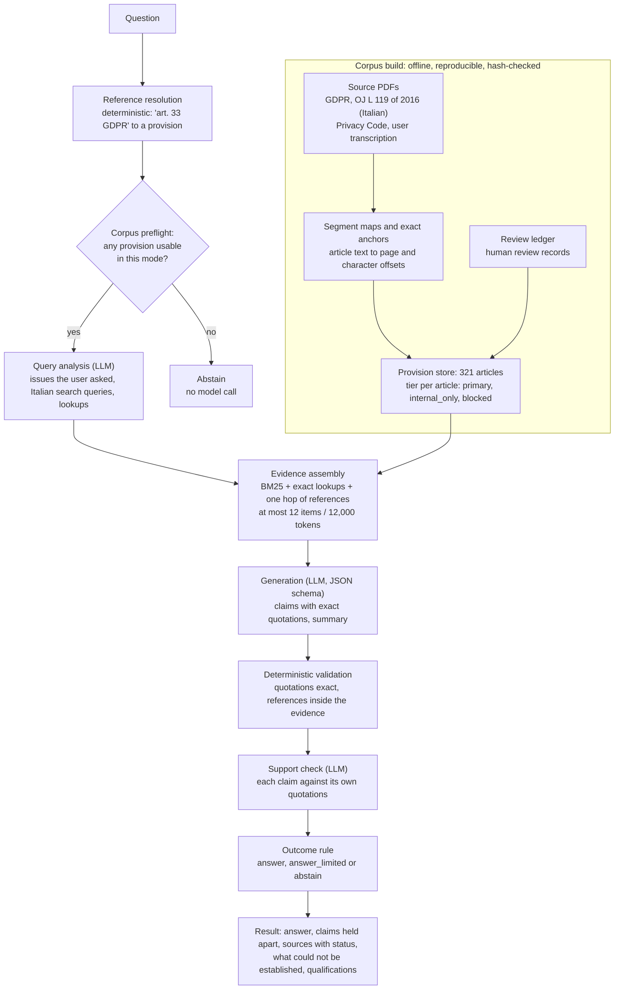

# Legal Research RAG

A retrieval-augmented question-answering prototype for Italian data-protection law: the GDPR and
the Italian Privacy Code.
- Every statement in an answer quotes the provision it rests on, and the quotation is checked
  character by character against the source.
- Every source states how far it can be trusted.
- When the evidence is not enough, the system says what it could not establish, or abstains.

> **Not legal advice.** This is a research and software-engineering prototype. Its output must
> not be relied on as a legal opinion.

## The problem

A legal answer is only useful if a professional can check it quickly. Language models write
fluent answers, but they also cite provisions that do not exist and quote text that is not in
the source. They also state as settled what the source says only in part.

The sources differ in reliability too: an official publication, an unofficial transcription and
a text nobody has reviewed should not be cited in the same way.

This project treats those problems as engineering constraints. The code enforces what can be
checked deterministically: exact quotations, references inside the evidence, and which sources
may be cited. A model assesses only what cannot be checked that way, and the answer says it was
a model's assessment.

## What it does

One real answer from the final benchmark run (question a10, research mode, shortened):

```text
question: Entro quanto tempo va notificata una violazione dei dati personali al Garante?
outcome: ANSWER                                   as of: 2026-11-17

C1 (source statement; support: supported) In caso di violazione dei dati personali, il titolare
   del trattamento notifica la violazione all'autorità di controllo competente senza
   ingiustificato ritardo e, ove possibile, entro 72 ore dal momento in cui ne è venuto a
   conoscenza.
   E2: «senza ingiustificato ritardo e, ove possibile, entro 72 ore dal momento in cui ne è
        venuto a conoscenza»
   ... (C2, C3, C4 on Code Art. 2-bis naming the Garante, C6)

citations: [E1] Privacy Code Art. 2-bis: unofficial transcription, pending human review
           [E2] GDPR Art. 33: 2016 original publication, pending human review

Partially supported or uncertain — not part of the answer:
C5 (inference; support: partially supported) Il termine per notificare la violazione al Garante
   è quindi ... salvo che sia improbabile un rischio ...    <- the exception is not quoted

qualifications: research-mode notice · validity not established · as-of date ·
  Digital Omnibus caveat (COM(2025) 837, not adopted) — in Italian for an Italian question
```

The model writes the claims. The code decides the rest:
- which claims stay in the answer, and the outcome;
- the source status and the qualifications;
- the lookup of Code Art. 2-bis, because the question names the Garante.

## Try it

| What | Command | Needs |
|---|---|---|
| **Replay of saved answers** (12 dev questions, final run, no model call) | `.\.venv\Scripts\python.exe -m http.server --bind 127.0.0.1 --directory demo\replay 8001`, then open http://127.0.0.1:8001/ | Python only |
| Live web demo | `.\.venv\Scripts\python.exe -m src.web_demo` | The local corpus build and an Anthropic API key |
| Offline pipeline demo | `.\.venv\Scripts\python.exe -m src.demo` | Nothing (synthetic act, scripted model replies) |
| Tests | `.\.venv\Scripts\python.exe -m pytest` | Nothing (offline; tests needing the local build are skipped without it) |

The replay is a static site and can be hosted anywhere: see
[docs/deploy-replay.md](docs/deploy-replay.md). Setup and every command:
[docs/REFERENCE.md](docs/REFERENCE.md).

## Architecture



- **Modes** are evidence policies over one pipeline. Verified mode uses only provisions with a
  recorded human review; research mode also uses those pending review, each marked.
- **Model client:** one client (`src/llm.py`) serves every model step. It returns structured
  JSON, retries once on a malformed reply, and records token usage.
- **Benchmark model:** `claude-sonnet-5-5`.
- **Main modules:** `answer_generation.py` (pipeline, outcome rule), `evidence.py`,
  `query_analysis.py`, `support_verification.py`, `source_status.py`, `web_demo.py` and
  `web_replay.py`, all in `src/`.

## Guarantees

**Enforced by code, on every answer:**
- **Exact quotations.** A claim must quote the evidence it cites exactly, after a documented
  normalisation of whitespace, layout markers and soft hyphens. Otherwise it is removed.
- **References inside the evidence.** Every article a claim names must be a cited provision, or
  one the cited text names. Otherwise the claim is removed.
- **A citation gate.** Only provisions of the mode's tiers become evidence. In verified mode,
  with no human review recorded, a question abstains before any model call.
- **Claims held apart.** A claim the support check did not rate SUPPORTED is shown separately
  and is not part of the answer.
- **An outcome rule.** The outcome is `answer` only if every issue has a SUPPORTED claim and the
  model reported none as only partly answered. Otherwise it is `answer_limited`.
- **Source status.** Each source states separately: official or unofficial transcription;
  compared with an official text or not; reviewed by a person or not; legal currency not
  established; citable or not.
- **Fixed qualifications.** Every answer carries its as-of date and a notice that legal
  validity is not established. GDPR Art. 33 answers add the Digital Omnibus caveat; research
  mode puts its notice first.

**Assessed by a model, not guaranteed:**
- whether a claim's quotations state everything it says (the support check);
- the issues a question raises, and what to search for.

**Not established at all:** whether any provision is valid, in force or applicable at any date.
The GDPR text is the 2016 original publication; the Privacy Code text is an unofficial
transcription supplied by the user.

## Evaluation

**The benchmark, `answers-v0`:**
- 22 questions in Italian and English (12 dev, 10 test). Two of them must abstain.
- Each question has an expected outcome and the "core" provisions an answer needs.
- Scoring is deterministic and offline, stage by stage: are the core provisions among the
  candidates, in the evidence given to the model, and cited in the main answer?
- Every model reply is saved with hashes of its prompt, message and schema, so a later change
  is re-measured on the same replies, offline.

The figures use the expectations as drafted: **candidate expectations, not owner-reviewed**.
All runs are in research mode. Details:
[docs/evaluation/answers-v0-results.md](docs/evaluation/answers-v0-results.md).

| | Baseline | T6: evidence selection | T7: query analysis | Final |
|---|---|---|---|---|
| Evidence limits | 5 items / 3,000 tokens | 12 / 12,000 | 12 / 12,000 | 12 / 12,000 |
| Issues per question | 4–8 | 4–8 | 1–2 | 1–2 |
| Core provisions among the candidates | 100% | 100% | 100% | 100% |
| … in the evidence given to the model | 76% | 97% | 99% | 99% |
| … cited in the main answer | 81% | 95% | 98% | **91%** |
| Outcome matches | 3/22 | 8/22 | 9/22 | **18/22** |
| Claims in the answer / held apart | 175 / 10 | 200 / 10 | 121 / 13 | 105 / 33 |

1. **Retrieval was not the bottleneck.** Every core provision was among the candidates in every
   run. A comparison of BM25, hybrid and reranked retrieval could not move this benchmark, so
   it was dropped.
2. **Evidence selection was the bottleneck.** At 5 items and 3,000 tokens, fifteen core
   provisions never reached the model. T6 raised the limits and kept looked-up articles whole,
   merging matched spans otherwise. It also stopped lookups from crowding out search hits.
   Result: 76% to 97%.
3. **The outcome gap came from query analysis.** The analysis split questions into 4–8 issues,
   including topics nobody asked about, and the model then reported them unanswered. T7 limited
   the issues to what was asked.
4. **A rule that scored 22/22 was rejected.** That version of the outcome rule ignored the
   model's own report that an issue was only partly answered. The adopted rule keeps the report:
   17/22 on the same saved answers, re-scored offline.
5. **The final configuration** makes claims quote every element they list, rates each claim
   against its own quotations, and looks up Code Art. 2-bis when a question names the Garante
   or Italy. Result: 18/22.

**Citation recall fell from 98% to 91% by design.** This is a precision trade-off from the
stricter support check:
- A claim that states more than its own quotations cover is now held apart: still visible, but
  not part of the answer.
- Held-apart claims rose from 13 to 33. Evidence recall did not change.
- Citation recall fell only where the sole claims citing a core provision were held apart: a06
  (86% to 71%), a07 (78% to 56%) and a18 (100% to 0%; its expected outcome is `answer_limited`
  anyway).

In a legal answer, a statement that says more than its source is the failure that matters most.

The four remaining mismatches (a06, a07, a15, a22) are `answer_limited` where `answer` was
expected. In each, the model reported its question as only partly answered; a06 and a07 are
broad overview questions.

**Cost and variance.** The final run cost **$1.08** for 22 questions, from the API's reported
token usage, under a budget guard that stops a run before it can exceed its limit. It is a
single run, so model variance is not measured.

> **PLACEHOLDER: owner-reviewed scope** (pending the owner's review of the benchmark sheet).
> The runner also reports a scope with only owner-reviewed expectations. It is empty until the
> review sheet is applied. Then add its figures for the final run here.

## Research and verified modes

Both modes run the same pipeline and differ only in the provisions an answer may rest on:
- **Verified mode** (the default) uses only provisions a person has reviewed, as recorded in the
  ledger. None is recorded yet, so every verified question abstains before any model call.
- **Research demo mode** also uses the 319 articles pending review. Each is marked «human review
  pending», and a research notice comes first.

> **PLACEHOLDER: research vs verified example** (pending T8, the human review of GDPR Arts. 4,
> 33, 34, 55 and Privacy Code Art. 2-bis). After T8, add one question (a01 or a10) answered in
> both modes: the verified answer citing only reviewed provisions, the research answer, and the
> difference.

## Limits

- **The benchmark.** 22 questions with candidate expectations, not owner-reviewed: diagnostics,
  not validated results. One run, so model variance is not measured.
- **No human review recorded yet.** Verified mode abstains on every question, and every answer
  shown here rests on provisions pending review.
- **The sources.** The Privacy Code text is an **unofficial transcription** supplied by the
  user, not verified against an official text. Its PDF is not in the repository; the saved runs
  and the replay contain excerpts of it, labelled as such. The GDPR text is the 2016 original.
- **Scope.** Two acts, current text only: no case law and no point-in-time versions.
- **Retrieval.** The pipeline uses BM25 with exact lookups and one hop of references. The dense
  and hybrid retrievers in the repository are not used by the pipeline.
- **The model checks.** The support check is a model's reading, not legal validation. The
  summary check confirms that each sentence cites only supported claims, not that the sentence
  says what they say.

## Next steps

1. **More reviewed articles.** First T8: GDPR Arts. 4, 33, 34, 55 and Code Art. 2-bis. Then
   more, so that verified mode can answer.
2. **Point-in-time versions via Normattiva.** Use the Privacy Code in force at a given date, so
   that an answer can state which text applied when.
3. **Case law.** Add Garante decisions and court judgments as a source type with its own status
   and citation rules.
4. **An LLM judge calibrated on human labels.** Grade whole answers with a model judge whose
   agreement with owner-reviewed labels is measured before its scores are used.
5. **Owner review and variance.** Apply the owner's review of the benchmark, and make repeated
   runs to measure run-to-run variance.
6. **A retrieval benchmark.** Add questions whose provisions BM25 and the lookups miss, before
   comparing hybrid retrieval and reranking.

## Documentation

- [docs/REFERENCE.md](docs/REFERENCE.md): setup, configuration and every component, including
  ingestion, the retrievers, the provision store and corpus explorer, `ask`, the web demo and the
  replay. It also covers the detailed limitations and privacy.
- [docs/evaluation/answers-v0-results.md](docs/evaluation/answers-v0-results.md): every run,
  with per-question tables and findings.
- [docs/deploy-replay.md](docs/deploy-replay.md): hosting the replay.
- [docs/ROADMAP.md](docs/ROADMAP.md), [TECHNICAL_DEBT.md](TECHNICAL_DEBT.md) and
  [PROJECT_SPEC.md](PROJECT_SPEC.md).

## Licence

The code is released under the [MIT licence](LICENSE). Third-party texts in the repository keep
their own terms: see [official-sources/NOTICE.md](data/raw/trial-2026-10-10/official-sources/NOTICE.md).
PDF extraction uses PyMuPDF, which is licensed under the AGPL (or a commercial licence from
Artifex).
