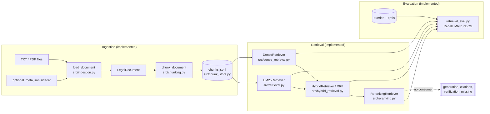
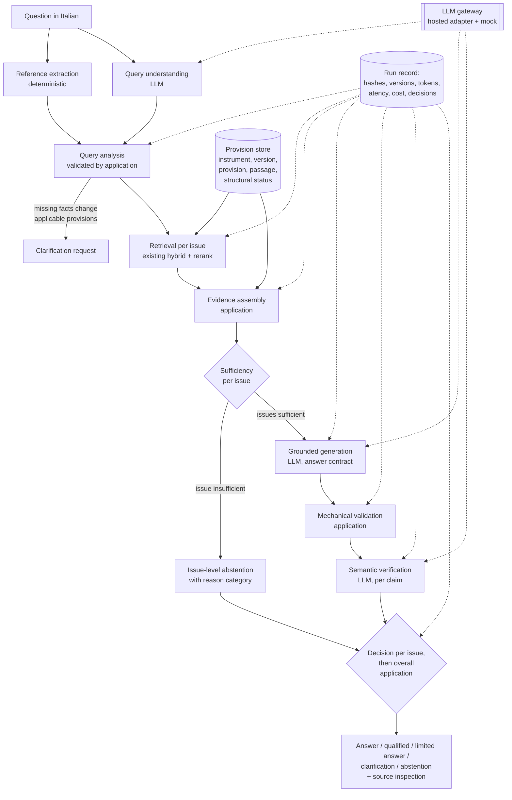
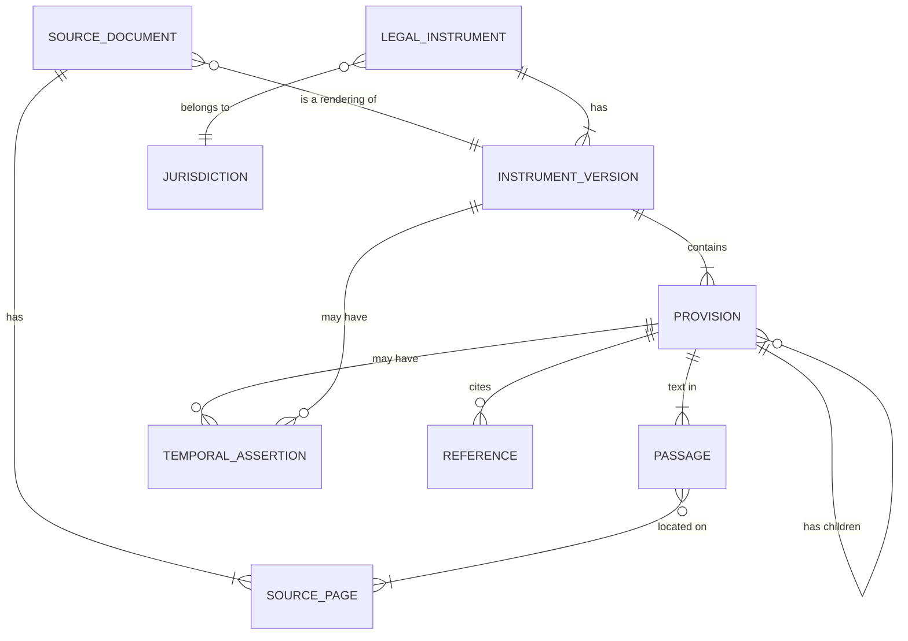
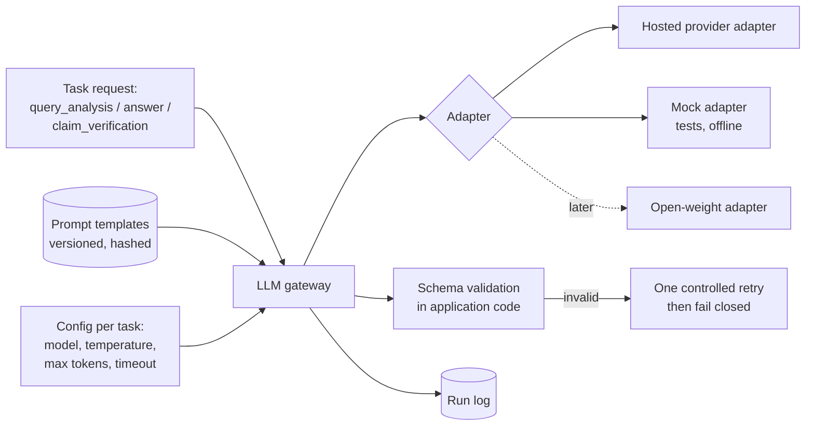
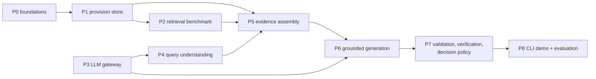

# Legal research assistant: architecture assessment and proposal

*Status: proposal for review, revision 2 with a consistency pass, 2026-11-06. Based on branch `feature/real-legal-corpus-trial` at `c284fc2`. Nothing described as "proposed" exists in the code.*

Labels used throughout:

- **Implemented** — exists in `src/` and is covered by tests in `tests/`.
- **Partial** — some of it exists, or it exists but is not wired into any pipeline.
- **Missing** — no code exists.
- **Proposed** — a design in this document, not yet built.

Passing tests show that the software does what its tests describe. They do not show retrieval quality on legal text, and they say nothing about legal correctness.

**Changes in revision 2:**

- a real hosted LLM is part of the first end-to-end prototype; the mock provider is for tests and offline work;
- temporal model split into requested date, corpus reference date and applicability status;
- explicit evidence-sufficiency criteria replace score thresholds, with three distinct kinds of insufficiency;
- explicit provision hierarchy and a structural validation status;
- a structured verification result per claim;
- decisions made per issue as well as for the whole answer;
- roadmap reworked.

**Consistency pass:**

- applicability now separates presence in a source, the source's own status representation and what the application can establish, with point-in-time coverage;
- S4 split into identified-but-unofficial (qualification) and unidentified (blocking);
- unchecked conditions produce a limited answer, never a complete conclusion;
- `QueryAnalysis` content treated as sensitive and not persisted by default;
- prompt-injection mitigations and verification limits stated as such.

---

## 1. Executive summary

The repository today is a **tested retrieval stack**, not a legal assistant. It can turn local TXT and PDF files into traceable chunks, search them with BM25, dense embeddings, RRF fusion and an optional cross-encoder reranker, and score rankings against human judgments. Everything after retrieval — query understanding, evidence assembly, LLM generation, citation validation, claim verification and abstention — is missing. The data classes for citations, claims and answers exist in `src/models.py`, but no code uses them.

The first real-corpus trial (GDPR and the Italian Privacy Code, November 2026) showed that the retrieval stack's foundations are sound on page provenance — extraction is lossless and every chunk maps to the right page — but weak on **legal structure**: annexes are not modelled, only the last heading level is kept, and labels are the only article identity. The real reranker has never been run, and no legal benchmark exists.

The proposal:

1. **Keep the retrieval stack** and wrap it in an evidence layer, rather than rebuilding it.
2. **Add a provision-centred data model** (instrument → version → provision → passage) with an explicit hierarchy, a structural validation status, and typed, nullable temporal assertions with a recorded basis for every date.
3. **Integrate a real LLM from the first prototype**, behind a provider-independent gateway, for three tasks: query understanding, grounded answer generation and claim-level verification. A mock provider exercises the same interfaces in tests.
4. **Keep the application in control**:
   - the application retrieves, assigns evidence IDs, resolves citations, validates identifiers and provenance, and applies qualifications;
   - the application decides whether to answer, qualify, clarify or abstain;
   - the LLM interprets, drafts and assesses support, but is never the authority on sources or citation identity.
5. **Decide sufficiency by explicit criteria, not by scores**, and per legal issue, so a three-issue question can be answered on two issues and explicitly declined on the third.
6. **Evaluate in three separate tiers**: retrieval, answer grounding, and legal correctness judged by qualified people. Add LLM operational metrics: schema validity, retries, latency and cost.

The pipeline stays linear. There is no autonomous agent and no open-ended tool-calling loop.

**Decision needed first:** how a structured, validated provision record is produced from the PDFs (section 11, D1). Every later layer depends on it.

---

## 2. Existing architecture map



### 2.1 Components

| Component | Location | Current behaviour | Interfaces and dependencies | Tests | Limitations | Reuse |
|---|---|---|---|---|---|---|
| Ingestion | `src/ingestion.py` (`load_document`, `ingest`, `main`) | TXT (UTF-8) and PDF; sorted batch; atomic JSONL rebuild; per-file errors, never silent skips; scanned PDFs rejected | `python -m src.ingestion --input … --output …`; PyMuPDF; `doc_id` = `doc-` + 16 hex chars of the file's SHA-256 | 27 functions in `tests/test_ingestion.py` | whole files only (no page range); title = file name; no URL, official identifier or version stored; running headers and footnotes kept in text; soft hyphens not rejoined; `doc_id` depends on bytes, including line endings (TD-005) | High: keep as the file-level reader |
| PDF extraction | `_read_pdf` in `src/ingestion.py` | text blocks joined by blank lines; page start offsets recorded | PyMuPDF `get_text("blocks")` | page-mapping and scanned-PDF tests | layout reading order only; no font or position information kept | High; would need layout features for structure (section 11) |
| Article and paragraph parsing | `src/chunking.py` (`_classify_heading`, `_split_blocks`, `_group_units`) | line-level regexes for article and section headings (English, Italian); numbered paragraphs inside articles; ordinal suffixes incl. `-undecies`… and compound labels (`2-quaterdecies.1`, `2-sex-decies`, `2-septies-decies`, commit `c284fc2`) | internal to chunking | 34 functions in `tests/test_chunking.py`, many parametrised | one flat section field; no annex concept; `Art. N.` headings missed (45 in the Privacy Code annexes); `((1.` amended paragraphs unlabelled; references in prose can become headings (Issue 2); labels are the only identity | Medium: works as a first pass, not as a provision model |
| Chunking | `chunk_document` in `src/chunking.py` | chunks never cross article or section units; packs paragraphs up to `CHUNK_SIZE` characters; overlap only inside oversized paragraphs; chunk ID = doc ID + index + text hash | `LegalDocument` → `list[LegalChunk]` | as above | sizes in characters, not tokens; chunk IDs change with any chunking change (TD-016) | High as a passage producer |
| Metadata and provenance | `src/models.py` (`DocumentMetadata`, `SourceLocation`, `LegalChunk`), `src/chunk_store.py` | seven sidecar fields (jurisdiction, language, type, authority, three dates); location = source path, page range, section, article, paragraph | frozen dataclasses; JSONL | 18 + 4 functions | document-level dates only; no title, URL, version, annex, heading path or character offsets in the chunk record; the document record itself is discarded | Medium: extend, do not replace |
| BM25 | `src/retrieval.py` (`tokenize`, `index_tokens`, `BM25Retriever`) | accent folding; structural tokens `art:N`, `par:N` from metadata only; positive (Lucene) IDF | `search(query, top_k)`; `rank-bm25` | 59 functions | no stemming or synonyms (TD-010); in-memory, rebuilt per run | High |
| Dense retrieval | `src/dense_retrieval.py` | `intfloat/multilingual-e5-small`, E5 prefixes, cosine; embedding cache keyed by model and chunk content | `search`; `sentence-transformers`; `local_files_only` supported by the encoder but not passed by the evaluator | 38 functions; 1 opt-in real-model test | not legal-domain; silent 512-token truncation (TD-022); no relevance cut-off | High |
| Hybrid RRF | `src/hybrid_retrieval.py` | rank-only RRF, `rrf_k` 60, candidate depths 20 + 20, provenance of each stage kept in `method_ranks` / `method_scores` | `HybridRetriever(bm25, dense, …)`, `max_results`, `describe` | 62 functions; 1 opt-in real-model test | untuned (TD-049); "found by both" always wins at the defaults (TD-052) | High: the first-stage retriever for the assistant |
| Reranking | `src/reranking.py` (`CrossEncoderScorer`, `Reranker`, `RerankingRetriever`) | cross-encoder `cross-encoder/mmarco-mMiniLMv2-L12-H384-v1`, raw logits, deterministic ties, no fallback | `rerank(query, passages, top_k)`; wraps any `Retriever` | 84 functions | **never run with the real model** (not cached; the smoke test sits in an uncommitted stash); scores are not calibrated | Medium until validated |
| Evaluation | `src/retrieval_eval.py` | Recall@k, MRR@k, nDCG@k; strict query and judgment loaders; reports with file hashes; five retrievers incl. `hybrid-rerank` | `python -m src.retrieval_eval --retriever …` | 53 functions | only a 9-chunk synthetic fixture; no legal benchmark (TD-015); no answer or grounding evaluation | High for tier-1 evaluation |
| Configuration | `src/config.py` | 20 environment settings, validated | `load_settings()`, `python -m src.config` | 9 functions | 10 settings are read by no pipeline code: `RERANKER_ENABLED`, `LLM_PROVIDER`, `LLM_MODEL`, `LLM_API_KEY`, `FINAL_EVIDENCE_COUNT`, `CONTEXT_TOKEN_BUDGET`, `MIN_RETRIEVAL_SCORE`, `MIN_RERANK_SCORE`, `UNDATED_SOURCE_POLICY`, `MAX_GENERATION_RETRIES` | Medium |
| CLIs | ingestion, BM25, dense, hybrid search, evaluation | each prints traceable results | `python -m src.<module>` | CLI tests per module | no reranked search CLI; no question-answering entry point | — |
| Answer models | `Citation`, `Claim`, `LegalAnswer`, `VerificationStatus` in `src/models.py` | validated dataclasses (`Citation.source_id` must match `S1`, `S2`, …) | none | `tests/test_models.py` only | **not used by any pipeline code** | High as a starting point |

The test suite at `c284fc2` has 763 passing tests and 2 opt-in real-model tests skipped by default. That run is from the pre-commit check of that commit; it was not repeated for this document.

### 2.2 Evidence from the real-corpus trial

From `data/raw/trial-2026-10-10/structural_audit.md` (git-ignored) and later checks:

- **GDPR** (original OJ publication, 88 pages): all 99 articles recognised, in order, with exact labels. Running headers, 20 footnote lines and 117 soft hyphens pollute the text.
- **Privacy Code** (a user-provided transcription, 101 pages, "Vigente al: 5-11-2026" unverified): main body pages 1–53, Allegati A.1–C on pages 53–101.
  - At `c284fc2`: 276 of 321 headings recognised, all with exact labels.
  - 45 annex headings missed; annex text attributed to main-body articles; 18 article labels shared by more than one heading.
  - 52 amended paragraphs (`((1. …`) unlabelled.
- **Page provenance holds**: extracted text matches PyMuPDF character for character, and every page maps back correctly.

---

## 3. Capability matrix

| Capability | Status | Notes |
|---|---|---|
| TXT/PDF ingestion with page provenance | Implemented | whole files; no OCR |
| Document-level legal metadata | Partial | sidecar only; nothing in `src/` reads it after ingestion |
| Article / paragraph structure | Partial | flat labels; see trial evidence |
| Annexes, recitals, heading hierarchy | Missing | |
| Provision identity independent of label text | Missing | |
| Temporal validity (per document or provision) | Missing | document-level date fields exist, unused |
| Lexical, dense and hybrid retrieval | Implemented | quality unmeasured on legal text |
| Cross-encoder reranking | Partial | code tested with fakes; real model never run |
| Metadata or date filters | Missing | TD-055 |
| Query understanding | Missing | |
| Evidence assembly and sufficiency | Missing | |
| LLM provider interface | Missing | only settings exist |
| Structured answer, claims, citations | Partial | dataclasses exist, unused |
| Citation resolution and validation | Missing | |
| Claim verification | Missing | `VerificationStatus` enum exists, unused |
| Abstention | Missing | threshold settings exist, unused |
| Retrieval evaluation | Implemented | no legal benchmark |
| Grounding / answer evaluation | Missing | |
| User interface | Missing | spec asks for CLI and/or Streamlit |

---

## 4. Proposed target architecture

All components below are **proposed** unless the box says otherwise. Boxes marked **LLM** call the model through the gateway; every other box is application code.



### 4.1 Separation of responsibilities

| The LLM may | The application must |
|---|---|
| interpret the question, identify legal issues and missing facts | extract explicit references deterministically and validate any reference the LLM proposes against the provision store |
| propose structured sub-queries | run retrieval, select evidence and enforce the evidence budget |
| draft explanations grounded in the supplied evidence | assign evidence IDs and resolve every citation to passage, provision, document and page |
| assess whether a claim is supported by supplied passages | check citation existence, quoted spans, article-reference consistency and provenance |
| — | apply temporal and authority qualifications |
| — | decide, per issue and overall, whether to answer, qualify, clarify or abstain |

The LLM never produces source identifiers, article numbers, page numbers or source metadata that the application has not supplied. Anything of that kind in model output is either an evidence ID from the supplied set or a mention that is validated before it can appear in the answer.

### 4.2 Design rules

1. **Linear and inspectable.** Each stage is a function with typed input and output that can be run and tested alone, which follows `PROJECT_SPEC.md` §4. There is no planner loop and no tool-calling agent. Sub-queries run as a fixed fan-out.
2. **Retrieved text is untrusted data.** It is passed to the model as quoted evidence, never as instructions (`PROJECT_SPEC.md` §17).
   - Delimiters and "treat this as data" instructions are **mitigations, not guarantees**; a model may still follow instructions embedded in evidence or in the question.
   - The architecture therefore does not depend on the model resisting them. The LLM has no means to change retrieval, source or provision records, citation resolution or any application decision: its output is data that the application validates.
   - The worst a manipulated model can do is produce text and claims that fail validation or verification, or pass as a wrong but properly cited statement. That residual risk is why tier-3 human review exists.
3. **Every decision is recorded** in a run record (section 7.5).
4. **Retrieval is unchanged at its interface.** The evidence layer consumes `RetrievedPassage` objects from the existing `Retriever` protocol.

---

## 5. Evidence data model

### 5.1 Entities



| Entity | Purpose | Key fields |
|---|---|---|
| **Jurisdiction** | where an instrument applies | `code` (`EU`, `IT`), `name` |
| **LegalInstrument** | the act in the abstract | `instrument_id` (stable, e.g. `eu-reg-2016-679`, `it-dlgs-2003-196`), `type` (regulation, decreto legislativo, judgment …), `official_title`, `official_identifiers` (CELEX, ELI, URN, Gazzetta reference), `issuing_authority`, `jurisdiction` |
| **InstrumentVersion** | one text of the act | `version_id`, `instrument_id`, `version_kind` (original publication, consolidated text, transcription), `corpus_reference_date` (section 5.3), `authenticity` (authentic, official non-authentic, unofficial, user transcription), `source_documents` |
| **SourceDocument** | one file | `file_sha256`, `doc_id` (existing), `local_path`, `source_url`, `retrieved_on`, `producer`, `reuse_terms`, `notes` |
| **SourcePage** | a physical page | `doc_id`, `page_number`, `char_start`, `char_end` (already computed as `page_starts`) |
| **Provision** | a structural unit | see 5.2 |
| **Passage** | retrievable text | existing `LegalChunk` plus `provision_ids`, `char_start`, `char_end`, `page`, `page_end` |
| **Reference** | a citation inside text | `from_provision`, `raw_text` (`art. 6, par. 1, lett. f)`), `target_instrument`, `target_label`, `resolved_provision_id` or null, `resolution_method` |
| **TemporalAssertion** | a date fact | see 5.3 |

### 5.2 Provision hierarchy and structural status

`Provision` fields:

- `provision_id`: stable identity, `version_id` plus structural path (below);
- `version_id`, `parent_id`;
- `kind`, one of the levels below;
- `label_as_printed`: exact text, never altered (e.g. `2-quaterdecies.1`, `Art. 1.`, `lett. f)`);
- `normalised_label`: for matching only (e.g. lower case, trailing full stop removed);
- `path`: human-readable, e.g. `Parte I > Titolo I > Capo I > Art. 2-quaterdecies.1`;
- `title`;
- `status_marker`: printed status text, e.g. "((ARTICOLO ABROGATO DAL D.LGS. 10 AGOSTO 2018, N. 101))";
- `structural_status` and `structural_provenance` (below).

**Levels.** The model represents all of these. Not every level is parsed automatically in the first prototype.

| Kind | Italian forms | Example parent | First prototype |
|---|---|---|---|
| `part` | Parte | version | represented if detected |
| `title` | Titolo | part | represented if detected |
| `chapter` | Capo / Chapter | title or version | represented if detected |
| `section` | Sezione | chapter | represented if detected |
| `article` | Art., Articolo | any level above | **required** |
| `paragraph` | comma, paragrafo, numbered `1.` | article | best effort |
| `letter` | lettera `a)` | paragraph | not parsed; kept in text |
| `number` | numero `1)` | letter or paragraph | not parsed; kept in text |
| `recital` | considerando `(N)` | version | GDPR only, best effort |
| `annex` | Allegato | version | excluded in the current trial scope |
| `annex_article` | Art. inside an Allegato | annex | excluded in the current trial scope |

**Identity.** The structural path uses `kind:normalised_label` segments. For example, `it-dlgs-2003-196@<version>/body/article:2` and `…/annex:a.1/annex_article:2` are different provisions, which removes the annex collision seen in the trial. The printed label stays separate from the identity and is what the user sees.

**Structural status.** Every provision, and every passage-to-provision link, carries one of:

| Status | Meaning | May be cited in an answer? |
|---|---|---|
| `auto_unreviewed` | produced by the parser, not checked | yes, with a visible "structure not reviewed" qualification |
| `auto_verified` | produced by the parser, then checked by a person against the source | yes |
| `manually_curated` | entered or corrected by a person | yes |
| `ambiguous` | the parser or a reviewer could not settle it (e.g. `2-quindecies` / `2-quinquiesdecies` on Privacy Code page 9) | no: issue-level outcome `unresolved_structural_attribution` |

`structural_provenance` records who or what produced the record, when, and against which source (file hash and page). An `auto_unreviewed` attribution is never displayed as if it had been validated.

**Mapping to existing code.** `LegalChunk` stays the passage record. `SourceLocation.article` becomes a convenience copy of the innermost article label. `DocumentMetadata` dates move into temporal assertions. Chunk IDs are unchanged unless chunking changes.

### 5.3 Temporal model

Three different things are kept apart.

| Concept | What it is | Where it comes from |
|---|---|---|
| `requested_date` | the date the user asks about, if any ("al 1 gennaio 2018") | query understanding; null when the user gives none |
| `corpus_reference_date` | the date a source version claims to be current at | the version record, from a typed assertion (e.g. the transcription's "Vigente al: 5-11-2026", basis `stated_in_text`, unverified) |
| `applicability_status` | what the system can actually establish about a provision at the date of interest | computed by the application from the two dates above and the provision's assertions |

**Date of interest.** It is `requested_date` if given, otherwise the date the question is asked. A missing `requested_date` does **not** mean the corpus represents current law. It means the system must check whether the corpus covers the date of the question.

**Three layers, kept apart.** Each is recorded separately, and only the third is shown as applicability:

| Layer | Question it answers | Values |
|---|---|---|
| `present_in_version` | does the provision's text appear in this source version? | true / false, with the passage reference |
| `source_status_representation` | what does the source itself say about the provision's status? | `represented_in_force_at_reference_date` (a consolidated version that states a reference date and presents the provision as part of the text in force at that date); `marked_repealed`; `marked_not_yet_applicable`; `no_status_representation` (e.g. an original publication, which shows the text as adopted and says nothing about its later status) |
| `applicability_status` | what can the application establish at the date of interest? | the values below |

Presence in a version is never evidence of applicability, even in an authentic or official source. The **absence of a negative assertion** (no repeal, suspension or not-yet-applicable marker) is not, by itself, positive evidence either. The only positive basis this model accepts is a source that *represents* the provision as in force at a stated reference date, and even that establishes what the source says at that date, not what the law is.

**Temporal coverage.** A consolidated version with reference date T represents the text at T only. It does not establish the text applicable at any earlier date, because the provision may have been amended since. It also does not establish the text after T, because later changes are not reflected.

**Applicability status values:**

| Value | Condition | Shown to the user as |
|---|---|---|
| `stated_applicable_per_source` | `source_status_representation` is `represented_in_force_at_reference_date`; the date of interest is on or after the reference date T; and the version is authentic or official | "according to this source, in force at its reference date T; changes after T are not reflected" |
| `stated_applicable_unverified_source` | as above, but the version is unofficial or a transcription, or T is unverified | as above, plus the authority caveat |
| `stated_repealed` | `marked_repealed`, or a repeal assertion | "the source marks this provision as repealed" |
| `not_yet_applicable` | `marked_not_yet_applicable`, or a stated application date later than the date of interest (e.g. a GDPR question before 25.5.2018) | "not yet applicable at that date, according to the source" |
| `outside_source_coverage` | the date of interest is before the reference date of the only available consolidated version, or before the version's start; no version covers it | "the corpus cannot show the text applicable at that date" |
| `undetermined` | none of the above can be established, including every case of `no_status_representation` at a date after the adoption or application date | "applicability could not be established from the available sources" |

Rules:

- **No repeal information never means "in force".** The strongest status the system can give is "in force at the source's reference date, according to the source", and it says so.
- **The original-publication GDPR** has `no_status_representation`. For a date of interest from 25.5.2018 onwards, its provisions are `undetermined`: the text is shown as published on 4.5.2016, with the disclosure that amendments and corrigenda are not reflected. Before 25.5.2018 they are `not_yet_applicable`.
- **The Privacy Code transcription** claims reference date 5.11.2026, unverified. Questions on or after that date get at best `stated_applicable_unverified_source`; questions about any earlier date are `outside_source_coverage`.
- Whenever an issue's provisions are not `stated_applicable_per_source`, the answer must say so next to the affected statements.

**Typed temporal assertions** are kept from revision 1:

| Kind | Meaning | Example |
|---|---|---|
| `publication` | published in an official journal | GDPR: 4.5.2016, OJ L 119 |
| `entry_into_force` | legally in force | GDPR: twentieth day after publication (Art. 99(1)) |
| `application` | starts to apply, if different | GDPR: 25.5.2018 (Art. 99(2)) |
| `amendment` | a change made by another act | Privacy Code articles amended by D.Lgs. 101/2018 |
| `repeal` | the provision or act ceases | "((ARTICOLO ABROGATO DAL D.LGS. 10 AGOSTO 2018, N. 101))" |
| `consolidation_reference` | the date a consolidated text claims to be current at | transcription: "Vigente al: 5-11-2026" |

Each assertion records:

- `subject`: instrument, version or provision;
- `kind`;
- `value`: a date, a range, or a **rule** stated but not computed (e.g. "twentieth day following publication");
- `basis`: `stated_in_text` (with passage reference), `stated_in_metadata`, `derived` (with method) or `user_supplied`;
- `verified`: with who verified it and against what;
- `certainty`: `certain`, `stated_unverified` or `unknown`.

A missing assertion means *unknown*. A printed abrogation marker without a machine-readable date becomes a `repeal` assertion with `value = null`, `basis = stated_in_text`, `certainty = stated_unverified`.

### 5.4 Authority

`authenticity` and `version_kind` feed every answer. For example:

- the GDPR file is an **original publication** of an EU regulation; corrigenda are not reflected;
- the Privacy Code file is a **user transcription** of a consolidated text, not an authentic or official source.

Answers must show this, never hide it.

---

## 6. Query-to-answer sequence

```mermaid
sequenceDiagram
    actor User
    participant QU as Query understanding (LLM + rules)
    participant R as Retrieval (existing)
    participant EA as Evidence assembly
    participant G as Generation (LLM)
    participant V as Validation + verification
    participant D as Decision (application)
    User->>QU: question (Italian)
    QU->>QU: deterministic references; LLM issues, roles, missing facts, date
    QU->>QU: application validates the analysis
    alt missing facts change which provisions apply
        QU-->>User: clarification question
    end
    QU->>R: sub-queries per issue + direct lookups for validated references
    R-->>EA: ranked passages with stage provenance and scores (logged)
    EA->>EA: map to provisions; definitions, exceptions, cross-references
    EA->>EA: temporal and authority status; sufficiency per issue
    EA-->>D: insufficient issues with reason category
    EA->>G: evidence set E1..En for sufficient issues
    G-->>V: structured answer (statements + evidence IDs)
    V->>V: mechanical checks, then per-claim semantic verification
    V-->>D: verification results per claim
    D-->>User: per-issue outcomes, overall outcome, citations, caveats
```

### 6.1 Query understanding (proposed)

The output is a `QueryAnalysis` object. The real LLM fills the interpretive fields; deterministic code fills explicit references; the application validates the combined result.

| Field | How it is obtained |
|---|---|
| `language` | detection |
| `explicit_references` | deterministic extraction reusing the existing tokenizer (`art. 6`, `GDPR`, `d.lgs. 196/2003`, `Codice privacy`), validated against the provision store |
| `jurisdiction` | explicit mention, or LLM-inferred (EU, IT, both) with `inferred: true` |
| `requested_date` | explicit date or temporal phrase ("prima del 2018"); null otherwise |
| `legal_issues` | LLM: 1–n issue statements, each with an `issue_id` and one or more sub-queries |
| `entities_and_roles` | LLM: e.g. titolare, responsabile, interessato, datore di lavoro, minore |
| `missing_information` | LLM: facts the answer would depend on |
| `needs_clarification` | LLM proposes; the application accepts it only when a missing fact changes which provisions apply, not merely the level of detail |
| `out_of_scope` | LLM proposes; the application confirms against the corpus scope |

Article numbers mentioned by the LLM but not found by deterministic extraction are treated as hypotheses. They are kept only if they resolve to a provision in the store, and they are never passed on as fact.

**Follow-up questions** carry the previous `QueryAnalysis` and evidence set. A follow-up may narrow the earlier analysis; a change of subject starts a new analysis. **Multi-issue questions** keep separate issues through every later stage.

### 6.2 Evidence assembly (proposed)

The input is passages from the existing `HybridRetriever` (or `RerankingRetriever` once validated, D6), one ranked list per sub-query, plus direct lookups for validated explicit references.

1. **Map passages to provisions** through the provision store; merge passages of the same provision.
2. **Expand deterministically:**
   - add the definitions provision for terms the question uses (e.g. GDPR Art. 4), from an explicit glossary map written and checked by a person;
   - add provisions referenced by an included provision, when the reference is resolved;
   - add sibling paragraphs carrying conditions or exceptions ("salvo", "ad eccezione", "fatto salvo", "in deroga").

   Expansion is bounded, and each added item records why it was added.
3. **Classify the role of each item:** `primary`, `definition`, `condition_or_exception`, `cross_reference`, `context`. A rule-based pass; LLM refinement is a later option, not part of the first prototype.
4. **Attach temporal and authority status** from section 5. Items are kept and flagged, not silently dropped.
5. **Flag competing evidence:** the same issue covered by an EU and an Italian provision, or by a repealed and a current text.
6. **Check sufficiency per issue** (section 6.3).
7. **Budget:** `CONTEXT_TOKEN_BUDGET` and `FINAL_EVIDENCE_COUNT` (existing settings, now used) cap the set. Truncation is reported.

The output is an `EvidenceSet` with items `E1…En`. Each item carries:

- the provision path and printed label;
- the passage text and page range;
- the source document and version;
- authority, applicability status and structural status;
- its role;
- retrieval provenance, including scores, which are logged and displayed, never used as a sufficiency test.

### 6.3 Evidence sufficiency (proposed)

Retrieval and reranker scores are not calibrated (TD-021, TD-043, TD-051). They are logged and may be shown, but **they never establish sufficiency on their own**. An issue is sufficient only if all of the following hold:

| # | Criterion | Failure category |
|---|---|---|
| S1 | at least one item with role `primary` that identifies a specific provision | `insufficient_evidence` |
| S2 | that provision's passage, provision, document and page links are complete | `unresolved_structural_attribution` |
| S3 | no item the answer would rely on has structural status `ambiguous` | `unresolved_structural_attribution` |
| S4a | the source is identified (instrument, version, file hash, provenance), even if it is unofficial or its reference date is unverified | not a failure: qualification (authority caveat) |
| S4b | the source's identity, version and provenance are known | `insufficient_source_metadata`: blocks reliance on that item |
| S5 | conditions and exceptions found in assembly are included; if they have not been checked, the issue is limited (below) | limitation, not a failure |
| S6 | every issue in the `QueryAnalysis` has been assessed | answer-level: a skipped issue is a defect |

**S4 in practice.** An identified but unofficial source (the Privacy Code transcription) can support a qualified answer. A passage whose source cannot be identified (unknown file, version or origin) cannot support any answer, however relevant its text looks.

**S5 in practice.** "Conditions not checked" never allows a conclusion to be presented as complete. For such an issue the answer is **limited**:

- it may contain `source_statement`s describing what the cited provisions say;
- it may not contain an `inference` applying the law to the user's facts, or any statement presented as the complete legal position;
- it carries the qualification "conditions and exceptions have not been checked".

If the question can only be answered with such a conclusion, the issue is declined instead.

The three categories mean different things to the user and are reported separately:

- **`insufficient_evidence`:** the corpus does not appear to contain a provision addressing the issue.
- **`insufficient_source_metadata`:** relevant text was found, but its source identity, version or provenance is unknown (S4b). An identified source that is merely unofficial is a qualification, not this category.
- **`unresolved_structural_attribution`:** relevant text was found, but which provision it belongs to cannot be stated reliably.

A person reviewing outputs can tell from these which part of the system to fix.

---

## 7. LLM integration (proposed)

### 7.1 Strategy

The first end-to-end prototype uses **one real hosted LLM provider** behind a provider-independent gateway for three tasks:

1. query understanding and issue decomposition;
2. evidence-grounded answer generation;
3. claim-level semantic verification.

A **mock adapter** implements the same interface for automated tests and offline development. It exercises the same failure paths: schema errors, retries, timeouts and refusals. It is not the demonstration mode.

Open-weight or local models are a later comparative experiment, not a prerequisite for the first demonstration.



### 7.2 Gateway interface

- **Call:** `complete(task, prompt_version, inputs, schema, settings) -> StructuredResult | GatewayError`. Callers depend only on this interface; adapters translate to each provider.
- **Structured outputs:** one JSON schema per task, validated by the application whatever the provider promises. Provider-native structured-output features may be used, but they do not replace validation.
- **Configuration:** model, temperature, token limits and timeout per task. These extend the existing `LLM_PROVIDER`, `LLM_MODEL` and `LLM_API_KEY` settings.
- **Retries:**
  - transport errors and timeouts: limited retries with backoff;
  - schema-invalid output: one retry with the validation error included (`MAX_GENERATION_RETRIES`, 0 or 1);
  - then fail closed: the task's issue or answer becomes an abstention with reason `generation_failed`;
  - never retry on content in search of a different answer.
- **Errors** are typed (transport, timeout, schema, refusal, budget) so the decision layer can report them.

### 7.3 Prompt and context engineering

- **Versioned templates** live in the repository; each call records template name, version and hash.
- **The evidence block** is assembled by the application. Each item is delimited and labelled with:
  - its evidence ID;
  - its printed label and path;
  - instrument and version;
  - authority and applicability status;
  - the passage text.
- **Untrusted text:** the system instructions say that evidence text is quoted material and may contain instructions to ignore. This reduces, but does not prevent, prompt injection (see 4.2, rule 2).
- **Grounding rules in the prompt:**
  - use only supplied evidence;
  - cite evidence IDs, never article numbers alone;
  - mark interpretation and inference as such;
  - state missing conditions and uncertainty;
  - leave an issue unanswered rather than fill gaps from general knowledge.
- **Context budget:** the evidence set is capped before the call; the prompt states which issues were left out and why.

### 7.4 Provider selection

No permanent provider decision is built into the architecture. The first implementation uses one practical hosted provider, chosen on:

- API reliability;
- structured-output support;
- quality in Italian legal prose;
- cost and latency;
- data-handling terms;
- integration effort.

That choice is decision D4, recorded with its reasons. Because the adapter is replaceable, the comparison can be repeated later on the same benchmark.

Which tasks might later move to smaller or local models is an open question for the evaluation (section 9.4), not an assumption.

### 7.5 Observability and privacy

**Per-call run log:**

- provider and exact model identifier returned;
- task, prompt template version and hash;
- input and output hashes;
- token counts, latency and cost (when the provider reports usage; price table in configuration);
- retry count and error type;
- schema-validation result.

**Per-question run record, by default:**

- hashes of the question, the `QueryAnalysis` and each model output;
- non-sensitive identifiers and flags: issue IDs and count, validated provision IDs, evidence IDs, `needs_clarification` and `out_of_scope` flags, verification statuses, per-issue and overall decisions with reason categories;
- operational metadata: models, prompt versions, tokens, latency, cost, retries;
- whether debug logging was enabled.

**Privacy:**

- the legal corpus is public, but **user questions can contain personal or confidential information**;
- structured data extracted from a question is treated as sensitive too: the `QueryAnalysis` can contain facts, roles and entities taken from the question, so not storing the question text alone is not enough;
- hosted inference requires explicit configuration, and the mock stays the default for tests and offline runs;
- by default, **none of these is persisted**: question text, full `QueryAnalysis` content (issue statements, entities and roles, missing facts, sub-queries) and model outputs;
- they are persisted only with explicit debug logging, or through another documented mechanism that has been reviewed for privacy. Debug logging is recorded in every run record it affects, so such records can be identified and removed;
- whether real user questions may be sent to a hosted provider at all is decision D5 (TD-045).

**Reproducibility:** temperature 0 where supported, recorded model identifiers, and versioned prompts. Hosted models can still change behaviour over time, so the run log, not determinism, is the reproducibility guarantee.

---

## 8. Citation, verification and decision strategy

### 8.1 Answer contract (proposed)

The generator returns JSON of this shape, validated by the application:

```text
Answer
  issues[]:
    issue_id                 # from the QueryAnalysis, not invented
    statements[]:
      claim_id               # assigned by the application after validation
      kind: "source_statement" | "interpretation" | "inference"
      text
      evidence_ids[]         # E1..En from the supplied set only
      quoted_span?           # optional exact quote from one evidence item
      depends_on[]?          # claim_ids, for inferences
    conditions_and_exceptions[]: text + evidence_ids
    uncertainty[]: text
    missing_evidence[]: text
  overall_qualifications[]
```

- **`source_statement`:** what a provision says; must cite evidence.
- **`interpretation`:** how a provision is read; cites the provisions read; labelled as interpretation.
- **`inference`:** a conclusion applied to the user's facts; lists the statements it depends on.

The application turns `evidence_ids` into `Citation` objects (the existing dataclass). Each citation carries:

- the application-assigned ID;
- the chunk and document IDs;
- the printed label and path;
- the page range;
- the source file and version;
- the structural status;
- the exact passage text.

### 8.2 Mechanical validation (deterministic, proposed)

1. Every `issue_id` and `evidence_id` exists in what the model was given.
2. Every citation resolves to a stored passage, provision, document and page.
3. Every `quoted_span` occurs verbatim in the cited passage.
4. Every article or provision mentioned in a statement's text (`art. 6`, `articolo 2-sexies`) resolves, and matches a provision cited for that statement. Otherwise it is an incorrect article reference.
5. Applicability and authority status of the cited provisions are attached to the statement.

Statements failing 1–4 are removed, or trigger the one regeneration; they never reach the user unflagged.

### 8.3 Semantic verification (LLM, proposed)

For each claim that passes mechanical validation, the verifier receives the claim and only its cited passages, plus the conditions and exceptions assembled for that issue. It returns:

| Field | Content |
|---|---|
| `claim_id` | the claim verified |
| `status` | `SUPPORTED`, `PARTIALLY_SUPPORTED`, `UNSUPPORTED`, `CONTRADICTED` (existing `VerificationStatus`), or `INCONCLUSIVE` |
| `supporting_evidence_ids` | the passages that support it |
| `contradicting_evidence_ids` | the passages that contradict it, if any |
| `missing_conditions` | conditions or qualifications present in the evidence but absent from the claim |
| `explanation` | a short reason for the decision |
| `inconclusive` | true when the verifier cannot decide (e.g. the passage is ambiguous or truncated) |

`INCONCLUSIVE` would be a new value in `VerificationStatus`, or a flag next to it; to be decided at implementation. The verifier's own output is schema-validated, and its evidence IDs are checked mechanically like the generator's.

**What verification is and is not:**

- It is a **control signal** that catches some unsupported or overstated claims.
- It is **not** a legal correctness certificate.
- It sees only the evidence set. It **cannot detect a condition or exception that was never retrieved or included**. `missing_conditions` covers only conditions present in the supplied passages, so retrieval and deterministic expansion (6.2) bound what verification can catch.
- Generator and verifier errors are **correlated**: they read the same passages, share similar training and may make the same misreading, even when they are different models. Using a separate verification prompt, and a different model where practical, reduces but does not remove this.
- Agreement between verifier and human judgment is measured in tier 2.
- Legal correctness is assessed only by qualified human review (tier 3).

### 8.4 Decision policy (proposed)

**Per issue:**

| Situation | Issue outcome |
|---|---|
| sufficiency failed (S1–S3, or S4b for every primary item) | `abstain`, with the reason category |
| every primary provision is `outside_source_coverage` at the date of interest | `abstain` (`outside_source_coverage`) |
| missing user facts change which provisions apply | `needs_clarification` |
| a `source_statement` is `UNSUPPORTED` or `CONTRADICTED` after one regeneration | `abstain` (`unsupported_claims`) |
| mechanical validation still fails after one regeneration | remove the statement; `abstain` if the issue loses its primary support |
| conditions and exceptions not checked (S5) | `answer_limited`: only `source_statement`s, no `inference` or complete conclusion, with the "not checked" qualification; `abstain` if the question needs a conclusion |
| `PARTIALLY_SUPPORTED`, `INCONCLUSIVE`, missing conditions reported by the verifier, competing sources, applicability `stated_applicable_unverified_source` / `stated_repealed` / `not_yet_applicable` / `undetermined`, an identified unofficial source (S4a) or `auto_unreviewed` structure | `answer_qualified`, with each qualification next to the affected statement |
| all statements `SUPPORTED`, conditions checked and stated, applicability `stated_applicable_per_source`, authority clean | `answer` |

**Overall:**

| Situation | Overall outcome |
|---|---|
| question out of scope | abstain |
| any issue `needs_clarification` and the clarification would change other issues | ask for clarification before answering |
| at least one issue answered (`answer`, `answer_qualified` or `answer_limited`) | answer those issues; list each other issue with its outcome and reason |
| no issue answered | abstain, listing each issue's reason |

A three-issue question with two supported issues is answered on two and explicitly declined on the third. Clarification is limited to one question at a time and at most two rounds.

---

## 9. Evaluation plan (proposed)

Three tiers, each reported separately, plus operational metrics. No result below exists yet.

### 9.1 Tier 1: retrieval (existing tooling)

- **Corpus:** frozen chunk file of the GDPR and the Privacy Code main body (current trial scope).
- **Judgments:** pooled top-20 of `hybrid` per query, graded 0–2 by a qualified reviewer, with written guidelines.
- **Metrics:** Recall@k, MRR, nDCG from `src/retrieval_eval.py`. Also:
  - per-query wins and losses for `bm25`, `dense`, `hybrid` and `hybrid-rerank`;
  - **provision-level recall**: did the right provision appear, regardless of which chunk. This needs the provision mapping.

### 9.2 Tier 2: grounding and answer quality (new tooling)

- citation validity (mechanical checks pass), citation precision (cited passage supports the statement), citation coverage (share of `source_statement`s with citations), supported-claim ratio;
- issue-level outcome accuracy against the expected outcome per item (answer, qualified, limited, clarify, abstain, and the reason category);
- abstention rate together with answer coverage; a low abstention rate is not automatically good (`PROJECT_SPEC.md` §15);
- verifier–human agreement on support, including how often `INCONCLUSIVE` is used.

### 9.3 Tier 3: legal correctness (human review)

A qualified reviewer grades each answer for:

- correctness;
- completeness (conditions and exceptions);
- correct article references;
- correct temporal framing;
- appropriate qualification.

The rubric and the reviewer are recorded.

### 9.4 Operational metrics (LLM)

Per task and per question:

- schema-valid rate on the first attempt;
- retry and failure rates;
- latency;
- tokens and cost;
- results by prompt version.

These support a later comparison of providers or smaller models on the same items; no such comparison exists yet.

### 9.5 First benchmark: question categories

| Category | Example shape (illustrative, not benchmark items) | Main tier |
|---|---|---|
| direct article lookup | "Cosa prevede l'articolo 2-quaterdecies del Codice?" | 1, 2 |
| definitions | "Che cosa si intende per dato genetico?" | 1, 2 |
| multi-article | consent requirements across GDPR and the Code | 1, 2, 3 |
| multi-issue | a question combining an answerable and an out-of-corpus issue | 2 |
| exceptions and conditions | when processing without consent is lawful | 2, 3 |
| cross-references | a Code article implementing a GDPR article | 1, 3 |
| EU vs Italian interplay | minor's consent age (GDPR Art. 8 vs Code) | 3 |
| temporal | text before vs after D.Lgs. 101/2018 | 3 (expected: `outside_source_coverage`) |
| ambiguous | a question needing a missing fact | 2 (expected: clarification) |
| outside the corpus | e.g. employment law unrelated to data protection | 2 (expected: abstention) |
| adversarial or misleading | a wrong article number, a false premise, or instructions embedded in the question | 2, 3 |

**Size for a first pass:** about 30 retrieval queries and 30 answer questions. All items, expected outcomes and grades are written by people, never generated.

---

## 10. Prototype implementation roadmap

Target: a CLI `python -m src.ask "<domanda>"` over the GDPR and the Privacy Code main body, using a real hosted LLM. It prints the per-issue and overall outcomes, the structured answer and each citation with page, provision path, structural status and passage, and saves a run record. The first demonstrations are restricted to questions whose evidence and source structure have been validated (P1, P2).



| Step | Deliverable | Depends on | Done when |
|---|---|---|---|
| P0 | Foundations: real reranker smoke run (needs download approval); decide how the Privacy Code main-body scope is applied; record the outcome in the manifest | — | real reranker loads and scores; scope realised with its own provenance entry |
| P1 | Provision store: instrument, version and provision records for both acts, with hierarchy, structural status and passage links | P0 | every main-body article of both acts has one provision with exact printed label; statuses recorded; checked against a human-supplied list of articles; ambiguous items listed |
| P2 | Tier-1 retrieval benchmark and first comparison | P1 | judgments committed with the chunk-file hash; per-query report; no claims beyond the numbers |
| P3 | LLM gateway: hosted adapter, mock adapter, schemas, retries, timeouts, run log, privacy defaults | — (can start with P0) | a real call returns schema-valid output; the mock reproduces schema, timeout and refusal failures; nothing is sent without explicit configuration; by default the run record holds no question text, `QueryAnalysis` content or model output (7.5) |
| P4 | Query understanding: deterministic references plus real-LLM analysis, validated by the application | P3, P1 for reference validation | schema-valid analyses on the answer questions; LLM-proposed references validated or discarded; clarification flag tested on ambiguous items |
| P5 | Evidence assembly and sufficiency (S1–S6) | P1, P2, P4 | evidence sets with reason categories for the benchmark questions, inspected by a person |
| P6 | Grounded generation with the real LLM; answer contract; application-assigned citations | P3, P5 | every citation resolves to passage and page; no model-originated identifiers reach the output |
| P7 | Mechanical validation, semantic verification (real LLM), issue-level and overall decisions | P6 | verification results carry all fields of 8.3; multi-issue items answered and declined per issue as expected |
| P8 | CLI demonstration and evaluation on the human-authored benchmark (tiers 2–3, operational metrics) | P7 | results reported with prompt versions and model identifiers; limitations stated; findings recorded in `TECHNICAL_DEBT.md` |

There is no mock-only end-to-end phase. The mock tests the same interfaces and failure paths the real provider uses, from P3 onward.

**Out of scope for the first prototype:**

- annex citation (unless D2 changes);
- case law;
- multi-version temporal reasoning;
- a web UI;
- open-weight model deployment;
- LLM-based evidence-role classification;
- agents.

---

## 11. Risks and unresolved decisions

### 11.1 Decisions needed

| ID | Decision | Options | Recommendation |
|---|---|---|---|
| D1 | How provision records are produced | (a) extend the regex chunker with layout features (bold titles, page position); (b) a structured official source (Normattiva Akoma Ntoso, EUR-Lex XML), needing a new parser and verified access; (c) a hand-curated provision index for the two acts | (c) for the pilot, cross-checked by (a), because a person-checked list of articles is also what the benchmark needs; plan (b) for scale |
| D2 | Annexes in the prototype | exclude (current trial scope) or model as `annex` / `annex_article` provisions | exclude first; add once provision identity exists |
| D3 | Privacy Code source | the current user transcription, or an official Normattiva export | obtain an export with recorded URL and date before any result is reported outside the team |
| D4 | First hosted LLM provider and model | chosen on the criteria in 7.4 | needed before P3; record the reasons |
| D5 | Hosted inference with real user questions | test questions only; with user consent; local only | test questions only until a privacy decision is made (TD-045) |
| D6 | Reranker in the default path | `hybrid-rerank` or `hybrid` | `hybrid` until P0 and P2 show the reranker helps |
| D7 | Verifier model | same model with a separate prompt, or a different model | a different model if D4 allows; measure agreement either way |
| D8 | First demonstration question set | which validated questions the demo may use | a subset of the P2/P8 benchmark whose provisions are `auto_verified` or `manually_curated` |

### 11.2 Risks

| Risk | Effect | Mitigation |
|---|---|---|
| Structural parsing errors (annexes, `Art. N.`, references read as headings) | wrong provision attribution; wrong citations | structural status; `ambiguous` blocks citation; provision store checked against a human list (D1) |
| Unverified source text and version | answers cite text that is not the law in force | authority and applicability status in every answer; `outside_source_coverage` when the corpus cannot show the date |
| Temporal metadata mostly unknown | wrong applicability | `undetermined` is a real status and is disclosed |
| Uncalibrated scores | false sufficiency or false abstention | scores logged only; sufficiency by criteria S1–S6 |
| LLM invents identifiers or sources | fabricated citations | evidence IDs only; mechanical validation; LLM-proposed references validated against the store |
| Generator–verifier correlated errors | unsupported claims pass | separate prompt and, if possible, model; human-agreement measurement; human review for correctness |
| Prompt injection through evidence or question text | model follows embedded instructions | delimiting and instructions reduce but do not prevent it; the LLM cannot change retrieval, records, citations or decisions; adversarial items in the benchmark |
| Exceptions never retrieved | an answer omits a condition and verification cannot notice | deterministic condition expansion (6.2); "conditions not checked" limits the answer (S5); tier-3 review |
| Hosted model drift or outage | results not repeatable; demo fails | run log with model identifiers; fail closed with `generation_failed`; re-run benchmark on model change |
| Cost and latency of three LLM tasks per question | slow or expensive demo | per-call tracking; evidence budget; per-question cost reported |
| Privacy of user questions | disclosure to providers | D5; mock default; no content logging by default |
| Small benchmark | unstable conclusions | per-query reporting; no aggregate quality claims |
| Reranker suitability for Italian legal text unknown | ranking may degrade | D6; measure before adopting |

### 11.3 Tensions to keep in view

- **Early real LLM vs validated structure.** P3–P4 can start before the provision store is complete, but generation and verification (P6–P7) are only meaningful on validated provisions. Demonstrations are therefore restricted to the D8 question set; a broader demo would show the model's fluency, not the system's reliability.
- **"Current law" questions.** With the current corpus, questions without a date get at best `stated_applicable_unverified_source` for the Privacy Code transcription, and `undetermined` for the GDPR original publication (text as published, amendments and corrigenda not reflected). Questions about earlier dates are `outside_source_coverage`. That is a correct result for this corpus, not a defect to be hidden.
- **Verification cost vs coverage.** Verifying every claim adds an LLM call per claim or per batch; the batching strategy is an implementation choice that the operational metrics should inform.

### 11.4 Existing debt most relevant to this plan

TD-002 (real documents), TD-003 (structure), TD-004 (title), TD-015 (benchmark), TD-016 (judgments tied to chunk IDs), TD-021 and TD-051 (score distributions), TD-022 (truncation), TD-041 (reranker unverified), TD-043 (calibrated thresholds), TD-045 (privacy), TD-055 (filters), TD-058 (ordinal suffixes) in `TECHNICAL_DEBT.md`.
