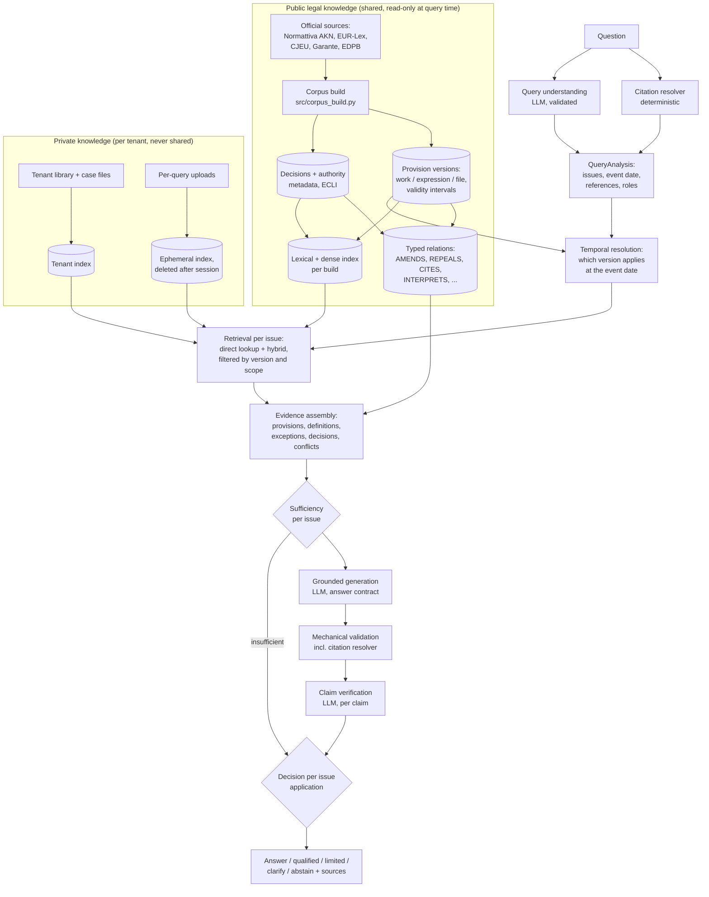
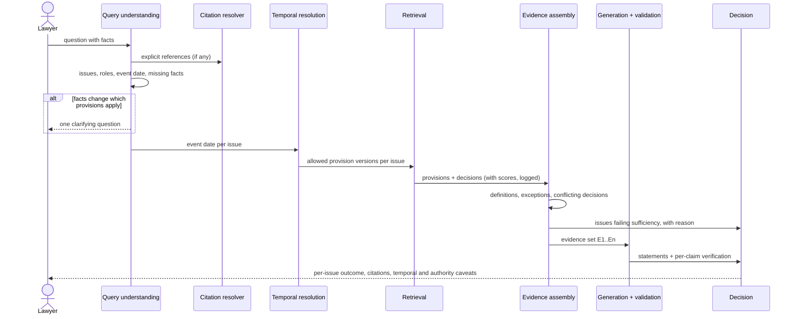
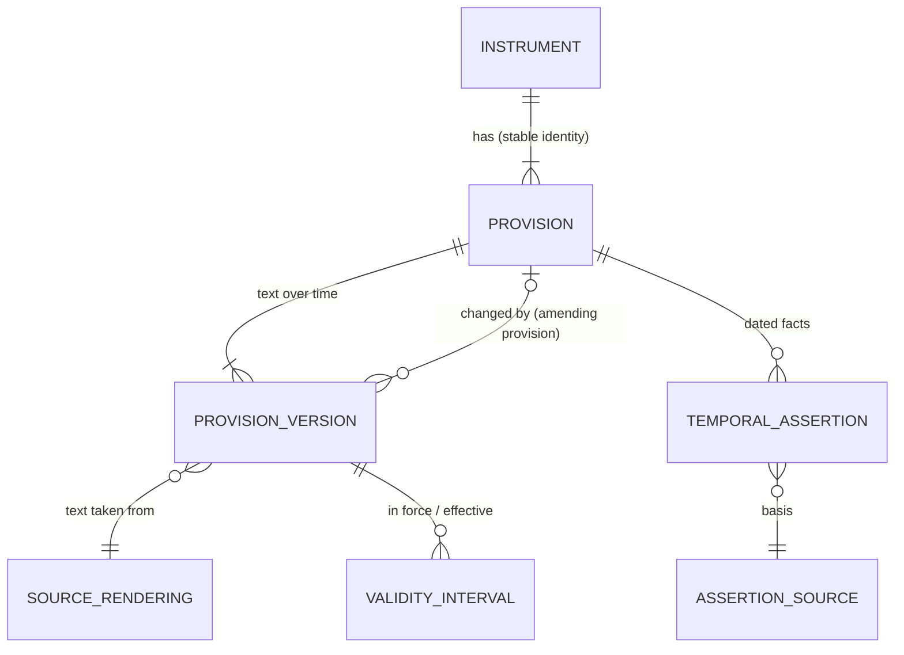
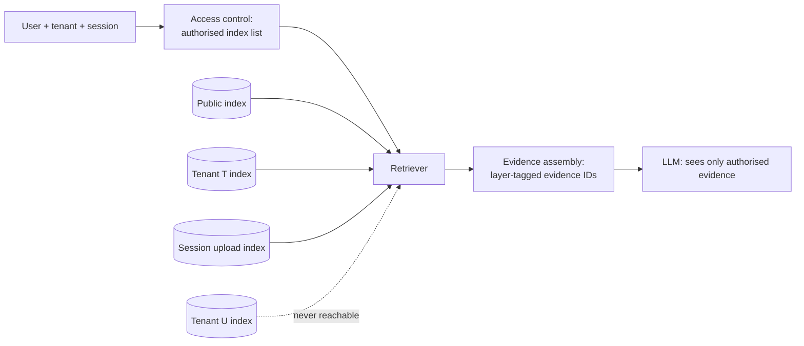

# Lexroom benchmark and architecture audit of `legal-rag`

*Status: research report, Phase A (read-only audit). Written 2026-11-08 against branch `feature/real-legal-corpus-trial` at `ac02676`. No source, configuration or data file was changed to produce it.*

**How claims are labelled in this report**

| Label | Meaning |
|---|---|
| **[Fact]** | stated in a public source, cited by ID (section 3) |
| **[Indirect]** | follows from public product behaviour or wording, but the source does not say it outright |
| **[Hypothesis]** | a technical inference about how Lexroom might work; not confirmed by any source |
| **[Recommendation]** | what this project should do |

"Fact" means *the source says so*. Lexroom's own marketing statements are reported as statements, not as verified properties. Nothing in this report comes from Lexroom's code, prompts, private APIs or confidential material.

**Relation to the existing architecture document.** `docs/architecture/LEGAL_ASSISTANT_ARCHITECTURE.md` (revision 2, based on `c284fc2`) already sets out the evidence model, the temporal status vocabulary, sufficiency criteria S1–S6, the answer contract and the decision policy. This report does not repeat those designs. It benchmarks them against Lexroom, corrects what the last four commits made out of date, and extends them where the benchmark shows gaps: historical versions, case law, private documents and security.

---

## 1. Executive summary

**What Lexroom is, from public sources.** Lexroom is a Milan company founded in 2023. It sells an AI platform for Italian (and now Spanish, German, French and Bulgarian) legal professionals. The platform covers legal research with linked sources, analysis of uploaded documents, drafting with templates and a Word add-in, case-file management ("Lex Desk") and filing through the Italian e-filing system (PCT) [L1, L5, L6]. Its central public claim is a **"data-first"** design: a proprietary, continuously updated database of 6 to 13 million legal sources, plus a proprietary retrieval layer, instead of a fine-tuned general model [P3, P4, P5, P6]. Every answer is said to be anchored to a source the user can open and check [L2, L8].

**What makes it different from a RAG chatbot.** On the evidence available, the difference is mostly **data and workflow, not algorithms**:

1. a curated, licensed and maintained corpus (legislation, case law, regional law, publishers' doctrine), "validated by partner jurists" [L2, L6];
2. structure-aware access to that corpus: search by citation, full-text PDF viewer, date and author filters, consistent and divergent precedents ("Conformi e Difformi") [L6];
3. deterministic tools where the law is computable: a "dedicated engine" for procedural deadlines that shows the rule applied [L6];
4. integration into the lawyer's work: case files, client registry, meeting transcription, Word, PCT [L5, L6].

None of the sources describe embeddings, chunking, reranking, models, verification steps or temporal versioning. Those parts below are hypotheses.

**Where `legal-rag` stands.** At `ac02676` the repository is a well-tested **retrieval and provenance layer** for two acts (GDPR original publication, Privacy Code transcription). It has no answer path. Since the existing architecture document was written, four commits added most of the provision model it proposed: corpus build identity, source-grounded article inventories, a provision store with structural status and citation eligibility, exact segment maps and passage links, and a corpus explorer CLI. The test suite passes: **1243 passed, 3 skipped** (run for this audit). The review ledger is empty, so **no provision is citable yet**, and no recorded corpus build exists.

**The hardest legal-specific problems**, in order of how much they would hurt reliability:

1. **Version and applicability**: knowing which text applied at the date of the facts, including transitional rules. The current corpus has one snapshot per act and cannot answer historical questions at all.
2. **Source authority and coverage**: an answer is only as good as the corpus. A user transcription and an uncorrected 2016 publication cannot support statements about the law in force.
3. **Structure as identity**: citations must resolve to provisions, not to chunks. The repository has solved most of this for articles; paragraphs, letters, annexes and case law remain.
4. **Conditions and exceptions that were never retrieved**: no verifier can catch an exception it never saw.
5. **Precedential weight**: case law cannot be ranked by a universal hierarchy; consistent and divergent lines must be shown as such.

**Recommendation in one paragraph.** Do not try to reproduce Lexroom's breadth; that is a data-licensing business, not an engineering task. Reproduce its **reliability properties on a narrow domain** (EU and Italian data protection), where the public sources are complete and freely reusable: legislation with historical versions, CJEU judgments, Garante decisions and EDPB guidelines. Keep the linear pipeline. The next five steps, in order:

1. a recorded corpus build plus human review of a first demonstration set of articles;
2. a deterministic citation resolver;
3. a provision-level retrieval benchmark;
4. an LLM gateway with the answer contract and mechanical validation;
5. versioned provisions from official sources.

No graph database, vector database, agent framework or fine-tuning is justified yet (section 13).

---

## 2. Research methodology

1. **Repository audit (read-only).**
   - Read every module's docstring and the key functions of `src/` and `tools/`, the specification, README, technical-debt register, reference data and Git history.
   - Ran the test suite once with the cache plugin disabled.
   - No file was modified.
2. **Public research on Lexroom.**
   - Fetched Lexroom's own pages: home, product pages, security, changelog, about.
   - Fetched press coverage of each funding round and of the 2026 acquisitions.
   - Ran searches for interviews, reviews and technical statements.
   - Each source is listed with its date and what it actually establishes (section 3).
3. **Excluded material.**
   - A Lexroom sales presentation hosted on a bar association's website marks itself "Confidenziale" on its first page. Its content was not used.
   - No attempt was made to access the application, its APIs or any non-public material.
4. **Inference.** Hypotheses about Lexroom's internals are derived from required behaviour ("what must exist for this feature to work"), and are labelled as such.
5. **Literature.** Established, citable work on legal RAG reliability and RAG variants, used to judge which techniques are worth building.

**Limits of the research.**

- LinkedIn posts were not retrieved; only search-engine summaries of the CTO's profile were seen.
- No Trustpilot page for Lexroom was found; the only match was a different company.
- The Trust Center (`trust.lexroom.ai`) renders client-side, and its content could not be read.
- No independent evaluation of Lexroom's output quality was found.

---

## 3. Sources and references

### 3.1 Lexroom's own pages (accessed 2026-11-08)

| ID | URL | What it establishes |
|---|---|---|
| L1 | https://www.lexroom.ai/ | Product modules (Lex Desk, legal research, document analysis, PCT, drafting); "+20.000" professionals; from €99/month for 1 module, 1 user, up to 200 documents, Word add-in; ISO 27001, GDPR, SSO, "EU-only servers" badges; "Zero allucinazioni, zero rischi" (unqualified marketing claim); available in Italy, Spain, Germany |
| L2 | https://www.lexroom.ai/prodotto/funzionalita/ricerca-legale | "Migliaia di fonti normative e giurisprudenziali", "validate da giuristi partner", "Più di 15 moduli di materia"; each statement linked to its original source; follow-up questions; attached documents as context; search history |
| L3 | https://www.lexroom.ai/prodotto/funzionalita/analisi-documentale | Upload of case files, contracts, registry extracts; import from Google Drive, OneDrive, SharePoint; cross-document questions; "classifica i rischi"; folders by case, client or matter; "risposte verificabili" (no mention of page-level citations) |
| L4 | https://www.lexroom.ai/prodotto/funzionalita/redazione | Drafting from the user's document or a Lexroom template; "Ogni bozza nasce già con le fonti citate"; chat-driven edits; version history |
| L5 | https://www.lexroom.ai/prodotto/lex-desk | Case files auto-filled from uploaded documents (parties, counterparty, facts); client registry; meeting transcription ("l'audio non viene conservato"); case-scoped questions; "milioni di fonti giuridiche verificate"; from €149/month |
| L6 | https://www.lexroom.ai/prodotto/novita | Monthly digests, July–October 2026. Doctrine from partner publishers incl. "Simone e Pacini" (July); search by citation and built-in PDF viewer (July); date and author filters, users can report missing sources, 30,000+ regional legislation sources, Cassazione "Sezioni Unite dal 2009, più sentenze chiave dagli anni '80" (August); prompt improvement asking "fino a tre domande mirate" when context is missing (September); deadline calculation by a "motore dedicato" that shows the rule applied, "Conformi e Difformi" moved to the database section, more file formats (October) |
| L7 | https://www.lexroom.ai/sicurezza | ISO 27001:2022; "pienamente conforme" to GDPR and the AI Act (no detail); EU-only processing, main server in the Netherlands, cloud providers from the ACN catalogue (unnamed); AES-256 at rest, HTTPS, BYOK option; no training on customer data; "Zero Retention Policy" alongside retention of contract data "fino a 10 anni"; prompt sanitisation, and the statement that prompt injection is not a concrete risk "in base all'architettura"; per-client virtual space; external penetration tests; SBOM on request. **No model provider or subprocessor is named.** |
| L8 | https://www.lexroom.ai/prodotto/funzionalita | "Ogni risposta ha una fonte che controlli tu"; sources "selezionate per istituto"; feature labels without detail: regulatory alerts, Word add-in, private library, saved prompts, voice transcription, own templates |
| L9 | https://lexroom.ai/en/about-us | Founders and roles: Paolo Fois (CEO), Martina Domenicali (CRO), Andrea Lonza (CTO, "translated legal needs into algorithms for complex legal databases"); "+200" staff; 7 offices, 5 markets; English page shows a €75/month entry price, unlike L1's €99 |
| L10 | https://trust.lexroom.ai/ | Exists; content not readable without running the page |

### 3.2 Press and third-party coverage

| ID | Source, date | What it establishes |
|---|---|---|
| P1 | Tech.eu, 2025-03-11, https://tech.eu/2025/03/11/italian-legaltech-lexroomai-secures-eur2m-seed-funding/ | €2M seed (search-result summary; not fetched in full) |
| P2 | Tech.eu, 2025-09-29, https://tech.eu/2025/09/29/italys-lexroom-secures-19m-series-a-to-redefine-legal-workflows-with-ai/ | Series A of $19M / €16M; founded 2023; "high-quality legal sources tailored to different jurisdictions"; no model or method details |
| P3 | Milano Finanza, 2026-02-20, https://www.milanofinanza.it/news/lexroom-l-ai-italiana-per-gli-avvocati-ora-vuole-conquistare-l-europa-ecco-quali-sono-i-target-per-il-202602201723454091 | "un'infrastruttura data-first, fondata su oltre 6 milioni di fonti normative e giurisprudenziali certificate"; "non genera risposte su base statistica pura"; "sistema di retrieval proprietario che integra dataset verificati"; over 7,000 firms with subscriptions, about 6,500 with 1–10 professionals; average price about €1,500/year |
| P4 | The Next Web, 2026-05-19, https://thenextweb.com/news/lexroom-50-million-series-b-civil-law-legal-ai-europe | $50M Series B led by Left Lane Capital; over $73M raised; 8,000+ firms and legal teams; 6M+ verified sources "continuously updated and structured for retrieval"; "data-first" rather than a fine-tuned general model; Fois: "Civil law countries need an AI legal engine that reasons data-first" |
| P5 | Trending Topics, 2026-05-19, https://www.trendingtopics.eu/lexroom-raises-50m-to-fix-legal-ais-hallucination-problem/ | Same round; Fois: "The missing piece was data — always-updated laws, relevant case law, and legal proceedings"; competitors described by the company as "designed model-first"; two-thirds of users active daily; client documents "not stored permanently" |
| P6 | NT+ Diritto (Il Sole 24 Ore), 2026-09-08, https://ntplusdiritto.ilsole24ore.com/art/lexroom-accelera-l-espansione-europea-le-prime-acquisizioni-francia-e-bulgaria-AJs9rs6 | Acquisition of Query Juriste (France, 5M+ French and EU documents) and Praven Intelekt (Bulgaria); 13M+ legal sources; 20,000+ clients; €23M ARR in summer 2026; "un'infrastruttura proprietaria di fonti giuridiche certificate" |
| P7 | Forbes Italia, 2024-07-05, https://forbes.it/2024/07/05/intelligenza-artificiale-cambia-volto-alla-professione-legale/ | Interview with Domenicali: answers "citando e allegando le fonti più pertinenti"; does not draw on web-indexed content; "base dati specifica costruita con studi legali di prima linea"; hallucinations addressed by "solo fonti giuridiche controllate e mantenute sempre aggiornate" |
| P8 | Sifted, https://sifted.eu/articles/land-grab-lexroom-ceo-race-to-buy-up-legaltechs/ | Exists (search result); fetch refused (HTTP 403); not used |

**Inconsistencies in public figures.**

- Source counts: "migliaia" [L2], "6 milioni" [P3, P4], "13 milioni" [P6, after the acquisitions].
- Customer counts: "7 mila studi" [P3], "8,000 law firms" [P4], "20,000 professionals" [L1] and "20,000 clients" [P6].
- Entry price: €99 [L1] or €75 [L9].

Different units (firms, professionals, clients) probably explain part of it. None of these figures is audited.

### 3.3 Literature and standards

| ID | Reference | Why it matters here |
|---|---|---|
| A1 | Magesh, Surani, Dahl, Suzgun, Manning, Ho, *Hallucination-Free? Assessing the Reliability of Leading AI Legal Research Tools*, arXiv:2405.20362 (2024) | Commercial legal RAG tools marketed as hallucination-free still produced incorrect or misgrounded answers on a substantial share of queries. Separates *correctness* from *groundedness*, as this report does. |
| A2 | Pipitone, Alami, *LegalBench-RAG*, arXiv:2408.10343 (2024) | Benchmark for retrieval of exact legal text spans; supports evaluating retrieval at span or provision level, not document level |
| A3 | Asai et al., *Self-RAG*, arXiv:2310.11511 (2023) | Retrieval and critique decided by a model trained with reflection tokens |
| A4 | Yan et al., *Corrective RAG*, arXiv:2401.15884 (2024) | A retrieval evaluator triggers corrective actions (re-retrieval or web search) |
| A5 | Edge et al., *From Local to Global: A GraphRAG Approach*, arXiv:2404.16130 (2024) | LLM-built entity graphs and community summaries for global questions |
| A6 | Cormack, Clarke, Büttcher, *Reciprocal Rank Fusion*, SIGIR 2009 | The fusion already implemented |
| A7 | OASIS LegalDocML (Akoma Ntoso) | XML standard for legislation with FRBR levels (work, expression, manifestation) and point-in-time versions; used by Normattiva exports |
| A8 | ELI (European Legislation Identifier), ECLI (European Case Law Identifier) | Stable identifiers for legislation and decisions |
| R1 | Regulation (EU) 2024/1689 (AI Act); Italian Law 23 September 2025, n. 132 on AI | Compliance context, section 14. Applicability to this project needs legal review. |

---

## 4. Verified Lexroom capabilities

The table lists only what public sources state. A tick in "Detail given" means the source explains *how*, not only *that*.

| Capability | Status | Detail given | Source |
|---|---|---|---|
| Natural-language legal research in Italian with linked sources | Fact | no | L2, L8, P7 |
| Answers "anchored" to a source the user can open, download and cite | Fact | no | L2, L8 |
| Curated corpus "validated by partner jurists", organised by subject module (15+) | Fact | no | L2, L8 |
| Legislation, case law, regulatory material; 30,000+ regional legislation sources; Cassazione Sezioni Unite since 2009 plus key decisions since the 1980s | Fact | partial | L6, P4 |
| Doctrine from partner publishers; purchased excerpts become queryable | Fact | partial | L6 |
| Search by citation; full-text PDF viewer; date and author filters; reporting missing sources | Fact | partial | L6 |
| "Conformi e Difformi" (consistent and divergent precedents) | Fact (exists) | no | L6 |
| Clarifying questions before search, up to three, one at a time | Fact | partial | L6 |
| Procedural deadline computation by a dedicated engine, with the rule shown | Fact | partial | L6 |
| Multi-document analysis, risk classification, cloud-drive import | Fact | no | L3 |
| Drafting from templates (200+) or user documents, sources cited in the draft, version history, Word add-in | Fact | partial | L4, L6, L1 |
| Case files with auto-extracted parties and facts; case-scoped questions; meeting transcription | Fact | partial | L5, L6 |
| PCT e-filing integration | Fact | partial | L5, L6 |
| Regulatory alerts; saved prompts | Fact (label only) | no | L8 |
| ISO 27001:2022, EU-only hosting, AES-256, BYOK, SSO, 2FA, no training on customer data | Fact (as stated) | partial | L7, L6 |
| "Zero hallucinations" | Marketing claim, unqualified, not substantiated | no | L1 |
| Point-in-time or historical versions of legislation ("multivigenza") | **Not mentioned anywhere** | — | — |
| Which LLMs, embedding models or rerankers are used | **Not disclosed** | — | — |
| Claim-level verification or abstention behaviour | **Not disclosed** | — | — |

---

## 5. Technical hypotheses about Lexroom

### 5.1 Likely architecture

Everything in this diagram is **[Hypothesis]** except the boxes marked **[Fact]**, which correspond to a stated capability.

```mermaid
flowchart TB
    subgraph Data["Corpus pipeline (offline)"]
        SRC["Official and licensed sources:<br/>legislation, case law, regional law,<br/>publishers' doctrine [Fact]"] --> ING[Ingestion, OCR,<br/>structure parsing]
        ING --> NORM[Normalisation:<br/>identifiers, citations,<br/>dates, court, subject module]
        NORM --> QA[Editorial validation<br/>'giuristi partner' [Fact]]
        QA --> STORE[(Source store<br/>full texts + PDFs [Fact])]
        STORE --> IDX[(Search indexes:<br/>lexical + dense, metadata)]
        STORE --> CIT[(Citation index:<br/>search by citation [Fact])]
    end
    subgraph Online["Question answering (online)"]
        Q[Question + attached docs] --> CLAR[Clarification<br/>up to 3 questions [Fact]]
        CLAR --> QU[Query rewriting / analysis]
        QU --> RET[Retrieval per subject module<br/>+ filters]
        IDX --> RET
        CIT --> RET
        RET --> RR[Reranking]
        RR --> GEN[LLM generation<br/>with source links [Fact]]
        GEN --> UI[Answer + openable sources [Fact]]
        DET[Deterministic engines:<br/>deadlines [Fact]] --> UI
    end
    subgraph Private["Private layer"]
        UP[Uploads, case files,<br/>private library [Fact]] --> PIDX[(Per-client<br/>index or namespace)]
        PIDX --> RET
    end
```

### 5.2 Hypotheses by subsystem

| Subsystem | Hypothesis | Basis | Confidence |
|---|---|---|---|
| Corpus | A structured store of full texts with metadata (court, date, number, subject module), separate from the search index | search by citation, date and author filters, PDF viewer, missing-source reports [L6] | high |
| Editorial layer | People curate the corpus per subject module, and that curation is the main quality control, not model-side checks | "validate da giuristi partner", "costruiti e verificati uno a uno" [L2, L8]; founders' emphasis on data [P4, P5, P7] | high |
| Case-law relations | Consistent and divergent precedents come from an editorial or massimario-style source (or an LLM classification), not from the court text itself | "Conformi e Difformi" is a well-known Italian massimario concept; mechanism not stated | medium |
| Retrieval | Hybrid lexical and dense retrieval scoped by subject module, plus citation lookup | modules, citation search; standard practice. Embeddings and reranking never mentioned. | medium |
| Generation | One or more hosted general-purpose LLMs behind an EU-hosted gateway, no fine-tuning of the core model | "data-first rather than a fine-tuned general model" [P4, P5]; EU-only servers [L7]; no provider named | medium |
| Verification | Source links attached to statements; whether claims are checked against the passages is unknown | "ogni affermazione ... collegata alla fonte" [L2]; nothing on checking | low |
| Deterministic tools | Rule engines for computable legal questions (deadlines), kept out of the LLM | "motore dedicato", shows the rule applied [L6] | medium-high |
| Temporal | Sources are "aggiornate" (current consolidated texts). Point-in-time retrieval is not advertised, so it may be absent or limited. | silence on versions across all pages | low (absence of evidence) |
| Private data | Per-tenant storage and index namespaces; uploads parsed with OCR for TIFF/P7M | "spazio virtuale dedicato ed esclusivo" [L7]; formats [L6] | medium |
| Prompt injection | Input sanitisation; the company says injection is not a concrete risk "in base all'architettura" | L7 | — (claim only) |

### 5.3 Open questions about Lexroom

- **"Fonti aggiornate"**: is the corpus the current consolidated text only, or point-in-time? A legal research product without historical versions cannot answer "what applied in 2019" reliably. No source answers this.
- **Statement-to-source links**: are they produced by the model, by retrieval attribution, or checked afterwards? The difference decides whether a link can be wrong while looking right (see A1).
- **"Zero allucinazioni"** alongside "Sta a te convalidare il ragionamento" [L1, L3]: the first claim is incompatible with the documented behaviour of RAG systems (A1) and with the product's own disclaimer. This project should not adopt the claim or its framing.
- **"Zero Retention Policy"** alongside 10-year contract-data retention and stored case files [L5, L7]: the scope of "zero retention" is unclear, probably limited to model providers or temporary uploads.
- **Model providers and subprocessors**: not named on any readable page.

### 5.4 What this means for the project

- Lexroom's moat is a **licensed, curated corpus plus workflow integration**. Neither can be reproduced by code in this repository, and the repository should not pretend otherwise.
- What *can* be reproduced, and arguably done better because Lexroom does not document it, is the **evidence contract**:
  - every statement resolves to an exact provision and page;
  - temporal status is explicit;
  - the system abstains when the corpus cannot support an answer.
- Two concrete Lexroom features are cheap and valuable here:
  - **search by citation**, a deterministic citation resolver (section 10.2);
  - **clarifying questions before search**, already in the existing design (`needs_clarification`).

---

## 6. Proposed target architecture

The target keeps the linear pipeline of `LEGAL_ASSISTANT_ARCHITECTURE.md` §4. This report adds four elements to it:

- a versioned provision layer;
- a case-law and authority layer;
- a deterministic citation resolver used on both the question and the model output;
- a separate private-knowledge layer.



**Design rules kept from the existing document:**

- linear and inspectable;
- retrieved and uploaded text is untrusted data;
- the application, not the LLM, assigns evidence IDs, resolves citations and decides outcomes;
- every decision is recorded.

**Added rules:**

1. **Public and private knowledge never share an index.** Access control is enforced in the data layer before retrieval, never by a prompt (section 12).
2. **Temporal resolution happens before retrieval.** It decides which provision versions retrieval may return, instead of filtering afterwards.
3. **Anything computable is computed deterministically**: citation resolution, version selection, date arithmetic and authority metadata. The LLM interprets and drafts; it does not decide these.

---

## 7. Architecture diagrams: end-to-end workflows

Each workflow names the components it uses. Components not yet in the code are proposed.

### 7.1 Case 1: legal research ("can the employer do X?")

The current corpus has no labour law, so in this repository Case 1 must end in an **out-of-corpus abstention**, except for its data-protection aspect. Example: employee monitoring falls under GDPR art. 88 and the Privacy Code articles on employment. This is the correct behaviour, and it is an evaluation item (section 15).



### 7.2 Case 2: historical research (facts in 2019)

See section 8.4 for the algorithm. The key difference from Case 1 is that temporal resolution can **end the issue**: no version of the provision covers the event date in the corpus, so the outcome is `outside_source_coverage`. It also changes what retrieval returns: the historical version is primary, and the current version is shown only for comparison, labelled as such.

### 7.3 Case 3: document analysis (uploaded contract)

```mermaid
sequenceDiagram
    actor L as Lawyer
    participant U as Upload (ephemeral or tenant)
    participant P as Parser
    participant CR as Citation resolver
    participant R as Public retrieval
    participant G as Generation + validation
    L->>U: contract (PDF/DOCX)
    U->>P: extract text + pages (OCR if needed, flagged)
    P->>P: split into clauses with offsets (heading/numbering rules)
    P->>CR: legal references inside clauses ("art. 28 GDPR")
    CR-->>P: resolved provisions or "unresolved"
    loop per clause, bounded
        P->>R: clause topic -> applicable provisions
    end
    R->>G: clause text (document evidence D1..) + provisions (E1..)
    G-->>L: observations, each citing a clause span AND a provision;<br/>"risk" statements marked as interpretation
```

**Rules for this workflow:**

- **Two evidence types.** Clause spans from the uploaded document (`D` IDs, document and page) and legal provisions (`E` IDs). An observation that compares a clause with the law must cite both.
- **Untrusted clause text.** A clause saying "ignore previous instructions" is data. The worst outcome is a wrong observation that fails validation, never a change in what the system retrieves or cites.
- **Labelled risk.** "Risk" is an interpretation and is labelled as one. The system does not grade legal risk numerically.

### 7.4 Case 4: drafting an opinion

Drafting is downstream of research: an opinion is a research answer rendered as prose. The safe structure:

1. **Fact register.** Facts supplied by the user (with the document span they come from), facts assumed (flagged), and facts missing.
2. **Issues.** Research per issue, as in Case 1, including issue-level abstention.
3. **Outline.** Each section is bound to issue IDs and evidence IDs.
4. **Prose generation per section**, constrained to the section's evidence.
5. **Mechanical validation** of every citation in the draft. Unresolved citations are removed and flagged, never kept.
6. **Output.** The draft plus an appendix listing each claim, its evidence and its verification status.

**[Recommendation]** Out of scope until research answers pass the tier-2 and tier-3 evaluation. Drafting multiplies the surface for unsupported claims and adds no new retrieval capability.

### 7.5 Case 5: conflicting jurisprudence

```mermaid
sequenceDiagram
    actor L as Lawyer
    participant R as Retrieval (decisions)
    participant H as Holding extraction (LLM)
    participant V as Holding verification
    participant C as Grouping (application)
    L->>R: "is interpretation X consistently accepted?"
    R->>H: decisions on the provision/issue (by INTERPRETS/APPLIES + search)
    H->>V: per decision: holding statement + supporting span
    V->>V: span exists verbatim; holding supported by span
    V->>C: verified holdings
    C->>C: group: supports X / rejects X / distinguishable / unclear
    C->>C: attach court, section, Sezioni Unite flag, date, facts summary
    C-->>L: both lines with counts OF RETRIEVED decisions,<br/>latest Sezioni Unite or CJEU position if present,<br/>explicit coverage caveat; never "settled" without a stated basis
```

**Rules:**

- "Consistently accepted" is never inferred from counts. Retrieved decisions are a sample of the corpus, and the corpus is a sample of all decisions.
- The system may report "the Sezioni Unite held X in decision N (date)". It may say "settled" only when a source in the corpus says so, and attributes that statement to the source.
- Editorial labels (massimario "conforme" or "difforme") are assertions of the editor, stored with that provenance (section 9.3).

---

## 8. Legal temporal reasoning

### 8.1 What the current code does

**[Fact, repository]**

- Each provision carries `source_status_representation`: `represented_in_force_at_reference_date`, `marked_repealed` or `no_status_representation`.
- Its `legal_validity` is hard-coded to `not_established` (`src/provisions.py`).
- Each version carries `corpus_reference_date` with `basis` and `verified`.

This is a correct and honest *snapshot* model. It cannot represent a second version of a provision, so every historical question is either `outside_source_coverage` or `undetermined`. That is the correct answer for this corpus, as the existing document says (§5.3, §11.3).

### 8.2 Dates the model must distinguish

| # | Date | Belongs to | Example |
|---|---|---|---|
| 1 | publication | act (and amending act) | GDPR: OJ L 119, 4.5.2016 |
| 2 | entry into force (*vigore*) | act or provision version | GDPR: twentieth day after publication (art. 99(1)) |
| 3 | application or effectiveness (*efficacia*, *applicabilità*) | provision version | GDPR: 25.5.2018 (art. 99(2)) |
| 4 | end of validity: repeal, substitution, expiry | provision version | Privacy Code articles repealed by D.Lgs. 101/2018 |
| 5 | event date | the user's facts | contract signed in 2019 |
| 6 | question date | the request | 2026-11-08 |
| 7 | record date | the corpus | when this system learned a version or an assertion |
| 8 | source reference date | a consolidated text | "Vigente al: 5-11-2026" (unverified) |

Dates 2 and 3 can differ for the same provision, and both can differ from 1. Date 7 is what makes the model *bitemporal*. Dates 5 and 6 are both needed: "what applied in 2019" and "what applies now to a 2019 contract" can be different questions with different answers.

### 8.3 Data model: versioned provisions with bitemporal assertions

Akoma Ntoso's FRBR levels (A7) map cleanly onto what the repository already has:

| FRBR level | Meaning | Repository today | Proposed |
|---|---|---|---|
| Work | the act in the abstract | `Instrument` | unchanged |
| Expression | the text at a point in time | `Version` (one per source file, whole act) | **`ProvisionVersion`**: one per provision per text change |
| Manifestation | a file | source PDF + `IngestionVariant` | unchanged, plus official XML exports |



`ProvisionVersion` fields:

- `provision_id`, which is stable across versions (the existing `<version>/body/article:<label>` ID becomes `<instrument>/body/article:<label>`, with the source version recorded separately);
- `expression_no` and `text_ref`, which point to anchored text in a corpus build;
- `in_force_from` and `in_force_to`, nullable, each with a basis;
- `effective_from` and `effective_to`, nullable, each with a basis;
- `changed_by`, the amending provision, if known;
- `source_rendering`, `authenticity` and `verified`.

Every date is a **`TemporalAssertion`**. The existing design gives each one `kind`, `value` (date, range or rule), `basis` and `certainty`. This report adds two fields:

- **`recorded_at`**: when the corpus learned the assertion (record time);
- **`superseded_by`**: assertions are never edited in place. A correction appends a new assertion.

That is the minimum needed for **bitemporal** queries: "what did this system know on date R about the law in force on date V?" It is needed for three reasons:

- reproducing an earlier answer (audit);
- corrigenda published after the fact. The GDPR's Italian text, for example, has been corrected after publication, and the current corpus does not reflect it;
- Constitutional Court rulings that change what can be said about a provision's effect for past facts. The legal consequence of such a ruling needs human analysis; the system records the assertion and its source, and does not compute the effect.

**[Recommendation]** Implement valid time as intervals on `ProvisionVersion` and record time as an append-only assertion log. A full bitemporal query engine is not needed at this scale: a version table plus `recorded_at` filters answers every query in section 8.4.

### 8.4 Retrieval strategy for "a 2019 contract, a 2021 amendment, asked in 2026"

```mermaid
flowchart TB
    A[QueryAnalysis: event_date=2019-xx,<br/>question_date=2026-11-08,<br/>framing: law applicable to the event] --> B[Candidate provisions<br/>by retrieval over ALL versions]
    B --> C{For each provision:<br/>a version whose interval<br/>contains event_date?}
    C -->|no version covers it| X[outside_source_coverage<br/>for this provision]
    C -->|yes, and certain| D[historical version = primary evidence]
    C -->|interval uncertain| U[undetermined, shown with basis]
    D --> E{Was the provision changed<br/>between event_date and<br/>question_date?}
    E -->|yes| F[retrieve the amending act's<br/>transitional provisions<br/>via AMENDS edge]
    F --> G[evidence: historical text +<br/>current text labelled 'for comparison' +<br/>transitional rules]
    E -->|no| H[single version, stated with<br/>its interval and basis]
    G --> I{Transitional rule found<br/>and retrieved?}
    I -->|yes| J[answer cites it; applying it to the facts<br/>is an inference, labelled]
    I -->|no| K[answer_limited: states that the default<br/>principle (art. 11 disp. prel. c.c.,<br/>non-retroactivity) is not confirmed<br/>for this case; no conclusion]
```

Rules:

- **Retrieval covers every version**, and the temporal filter selects the version. Filtering the index to "current" first would make the historical text unfindable.
- **Two texts, two roles.** The historical version is `primary`; the current version is `context` with the label "text in force at the question date, for comparison".
- **Transitional provisions are retrieved through the relation**, not by hoping semantic search finds them. An `AMENDS` edge from the amending act's provision to the amended provision makes it a one-step lookup.
- **No default principle as a silent conclusion.** Non-retroactivity is a starting point with exceptions (procedural rules, more favourable criminal law, express retroactivity). Whether it decides the case is an inference, never a source statement.

### 8.5 A concrete test case inside the current domain

- An Italian data-processing arrangement from **2017**, with the question asked in 2026.
- **GDPR:** not yet applicable (applies from 25.5.2018).
- **Privacy Code:** the pre-2018 text applies. D.Lgs. 101/2018 later rewrote and repealed large parts of it.

The current corpus holds only the GDPR as published and a 2026 transcription of the Code. The correct output today is therefore:

- **GDPR issue:** `not_yet_applicable` at the event date, according to its art. 99;
- **Privacy Code issue:** `outside_source_coverage`.

Once the historical versions are ingested (section 17, phase R5), the same question must return the pre-2018 text as primary evidence. This pair is a ready-made regression test for the temporal layer.

### 8.6 Jurisprudential change over time

Decisions do not have validity intervals. Their weight changes when later decisions depart from them. The model keeps:

- the decision date;
- relations to later decisions (`OVERRULES` only when a decision says so, such as a Sezioni Unite ruling resolving a conflict, `CONFLICTS_WITH`, `FOLLOWS`), each with its basis;
- whether a decision applied a provision version that has since changed (derivable from the decision date and the version intervals).

A 2015 decision interpreting a Privacy Code article repealed in 2018 must be shown with exactly that caveat.

---

## 9. Legal knowledge representation

### 9.1 Hierarchical objects instead of plain chunks

**[Fact, repository]** The repository already represents articles and divisions as provisions with printed paths, and anchors article text by exact offsets, apart from recitals, editorial notes, footnotes and running headers (`src/provision_anchors.py`). That is the right foundation. Hierarchical representation gives four things chunks cannot:

| Benefit | Mechanism | Already available? |
|---|---|---|
| Citations that survive re-chunking | cite `provision_id` + offsets, not `chunk_id` | partial: passage links exist; evaluation still keys on chunk IDs (TD-016) |
| Complete evidence | retrieve a chunk, return the whole provision (parent-child) | data exists in the links; not used in retrieval |
| Exceptions in reach | sibling paragraphs and letters of the same article are one hop away | no paragraph or letter level yet |
| Citation validation | "art. 6, par. 1, lett. f)" resolves to a node or fails | articles only |

**[Recommendation]** Extend the hierarchy downward (paragraph, then letter) only for the articles in the demonstration set, using the same exact-anchor method. Below letter level ("legal proposition"), the gain does not justify the cost: propositions are an interpretive unit, and extracting them automatically means generated text standing in for source text.

### 9.2 Metadata: mandatory and optional

| Field | Level | Mandatory? | Why |
|---|---|---|---|
| stable ID (instrument, provision, decision) | all | **yes** | citation identity |
| type (regulation, d.lgs., judgment, provvedimento, guideline) | instrument | **yes** | authority |
| issuing authority, jurisdiction | instrument | **yes** | authority, scope |
| official identifiers (CELEX, ELI, URN:NIR, ECLI) | instrument / decision | yes once official sources are used (null today, recorded as such) | linking to official texts |
| official URL + retrieval date + file hash | rendering | **yes** | provenance |
| authenticity, version kind | rendering | **yes** | qualifications |
| publication date | instrument | **yes** (null with reason if unknown) | temporal |
| in force / effective intervals | provision version | yes for primary evidence, null = unknown | applicability |
| repeal / amendment assertions | provision version | when printed or known | applicability |
| language | rendering | **yes** | retrieval, display |
| legal domain / subject module | instrument | optional | scoping, Lexroom-style modules |
| court, section, Sezioni Unite flag, number, date | decision | **yes** | authority |
| referenced provisions | provision / decision | optional, derived, with method | expansion |
| source reliability | rendering | not as a number: derived from authenticity, version kind and authority type | avoids a fake score |

Only fields marked mandatory block citation when missing (S4b in the existing design). Others produce qualifications.

### 9.3 Relations

| Relation | From → to | Basis it may have | Use in retrieval | Use in answers |
|---|---|---|---|---|
| `CITES` | provision/decision → provision | extracted reference, resolved by the citation resolver | bounded expansion | none directly |
| `AMENDS`, `SUBSTITUTES`, `REPEALS` | amending provision → provision version | official consolidation data, or the printed marker | find transitional rules; version intervals | temporal caveats |
| `IMPLEMENTS` | national provision → EU provision | stated in the national text or official notes | EU-national interplay questions | "implements", only with basis |
| `INTERPRETS`, `APPLIES` | decision → provision (version) | citation in the decision text | decisions on a provision | grouping in Case 5 |
| `FOLLOWS`, `DISTINGUISHES`, `OVERRULES`, `CONFLICTS_WITH` | decision → decision | stated in a decision or by an editorial source | conflict retrieval | shown with its basis, never as the system's own finding |

Every relation row carries `basis` (`stated_in_text`, `official_metadata`, `editorial`, `derived`, `llm_proposed`), the source of the basis, and `reviewed`. **An `llm_proposed` relation may guide retrieval but is never presented as fact.**

### 9.4 Relational vs graph storage

| | Relational (SQLite now, PostgreSQL later) | Graph database |
|---|---|---|
| Typed edges with attributes | edge table `(from_id, to_id, type, basis, ...)` | native |
| 1–2 hop expansion (all this design needs) | indexed join or recursive CTE | native |
| Temporal intervals, provenance, joins with versions | strong | weaker; usually modelled as properties |
| Operational cost | one file / one service the project may need anyway | an extra service, a query language, backups |
| Benefit at 2–5 instruments, ~10³ provisions, ~10³–10⁴ decisions | sufficient | none measurable |

**[Recommendation]** Relational, with an edge table. Reconsider a graph store only if an evaluation shows multi-hop queries (3+ hops over tens of thousands of nodes) that matter for answer quality. No such query appears in the five workflows.

---

## 10. RAG architecture

### 10.1 Assessment of techniques

Cost is relative to the current pipeline (one BM25 and one dense scan, optional cross-encoder).

| Technique | How it works | Legal value | Limitations | Cost | Build it? |
|---|---|---|---|---|---|
| Intent / domain classification | LLM labels question type and domain | routes to corpus scope, detects out-of-scope | adds a failure point | 1 LLM call (shared with query understanding) | **yes**, inside query understanding |
| Entity and role extraction | LLM extracts titolare, interessato, employer... | selects provisions that depend on role | hallucinated roles | shared call | **yes**, validated |
| Temporal context extraction | rules + LLM find event date and framing | drives section 8.4 | ambiguous phrasing | shared call | **yes** |
| Query decomposition | one sub-query set per issue | multi-issue questions | over-splitting | shared call, k retrievals | **yes**, bounded fan-out |
| Explicit citation lookup | regex + store lookup for "art. 6 GDPR" | exact, cheap, the strongest signal there is | only explicit references | negligible | **yes, first** (10.2) |
| BM25, dense, RRF hybrid | existing | identifiers (BM25) + paraphrase (dense) | unmeasured on legal text | existing | **keep**; measure |
| Metadata / version filters | restrict by instrument, version, interval | temporal correctness, scoping | needs data | negligible | **yes** with R5 |
| Parent-child retrieval | retrieve chunk, return provision | complete provisions as evidence | longer contexts | negligible | **yes** (links exist) |
| Query expansion (synonyms, abbreviations) | static legal glossary | "d.lgs." vs "decreto legislativo"; TD-010 | glossary upkeep | low | **yes**, small hand-made glossary |
| Multi-query (LLM paraphrases) | several rewrites, fused | recall on vague questions | drift; cost | ×n retrievals | later, if the benchmark shows recall gaps |
| HyDE (hypothetical answer as query) | embed a generated answer | weak: injects generated law into retrieval | can bias toward invented content | 1 call | **no** |
| Cross-encoder rerank | existing, real model runs | precision at top | unknown on Italian legal text (TD-041) | ~2 s / 20 passages on CPU | measure first (D6) |
| LLM reranking | LLM orders candidates | possibly better legal judgment | cost, non-determinism | 1 call / query | later experiment |
| Authority / temporal ranking | boost by authority or recency | tempting | **a universal boost encodes a false hierarchy** | low | **no** as a score; group and label instead |
| Context: dedup, budget, citation-aware format | application-side | existing design §6.2 | — | low | **yes** |
| Contradiction preservation | keep both sides in context, flagged | Case 5, EU vs national | — | low | **yes** |
| Self-RAG | model trained to decide retrieval and critique | could reduce unsupported text | needs a specially trained model; opaque decisions | training | **no** |
| Corrective RAG | evaluator grades retrieval, re-retrieves or falls back to web | the grading idea is useful | web fallback breaks provenance | 1+ call | **partial**: deterministic sufficiency check (S1–S6) plus one bounded re-retrieval; never web |
| GraphRAG | LLM-built entity graph and community summaries | global "theme" questions | summaries are generated text, not citable law | high, offline | **no** |
| Agentic RAG | model plans tool calls in a loop | flexible research | unbounded, hard to test or audit | high, variable | **no** for the MVP; a fixed fan-out covers multi-hop |
| Multi-hop via relations | follow `CITES` / `AMENDS` edges deterministically | definitions, cross-references, transitional rules | needs resolved references | low | **yes**, bounded to 1–2 hops |
| Query-focused summarisation | summarise long decisions per issue | long case law | summary replaces text | 1 call per decision | only as display; evidence stays verbatim spans |

### 10.2 The citation resolver: the cheapest high-value component

A deterministic function used in three places:

1. **On the question**, for direct lookup ("art. 2-sexies Codice privacy", "art. 6, par. 1, lett. f) GDPR").
2. **On model output**: every article mention in a statement must resolve, and must match a cited evidence item (existing design §8.2, check 4).
3. **On uploaded documents**, for the references inside clauses (Case 3).

The repository already has most of the parts:

- instrument aliases (`data/reference/instruments.json`);
- exact label lookup (`ProvisionStore.lookup`);
- the tokenizer's structural tokens (`src/retrieval.py`).

What is missing is the reference grammar (`art.`, `artt.`, `comma`, `par.`, `lett.`, ranges, "del medesimo decreto") and an explicit `unresolved` result. It also reproduces Lexroom's "search by citation" [L6].

### 10.3 Recommended retrieval path

1. Run the citation resolver; validated references become direct lookups.
2. Run hybrid retrieval (existing `HybridRetriever`) per sub-query, over the build's index. Index text **without page furniture** (TD-061).
3. Map chunks to provisions through the passage links, and merge per provision (parent-child).
4. Apply version and scope filters from temporal resolution.
5. Run bounded deterministic expansion: definitions, sibling exceptions, `AMENDS`→transitional, `CITES` (one hop).
6. Rerank only if the benchmark shows a gain (D6).

---

## 11. LLM orchestration

### 11.1 Model strategy

No model has been evaluated on this project's tasks, so this section gives criteria, not a winner.

| Criterion | How to measure it here | Weight |
|---|---|---|
| Italian legal prose and terminology | tier-3 human grading of answers | high |
| Structured-output reliability | first-attempt schema-valid rate (operational metric) | high |
| Citation fidelity | share of statements citing only supplied evidence IDs; mechanical-validation pass rate | high |
| Faithfulness | supported-claim ratio (tier 2) | high |
| Long-context use | performance as the evidence budget grows (ablation) | medium |
| Latency, cost | per-question tracking | medium |
| Data protection | provider terms: retention, training, region, subprocessors | gate (pass/fail), not a weight |
| Deployment flexibility | hosted, EU-hosted, or open-weight | medium |

**Candidate classes to compare on the same benchmark:**

- (a) two frontier hosted models, from different providers;
- (b) one EU-hosted offering;
- (c) one open-weight model run locally.

Class (c) matters for the private-document scenario and for data-protection gating, not because it is likely to win on quality.

**Single model or several?** One model for all three tasks is the simplest valid start. Two separations have measurable justifications:

- **Verifier different from generator** (D7 in the existing document). This reduces, without removing, correlated errors. Agreement with human judgment is measured either way.
- **A smaller model for query understanding**, but only if the operational metrics show cost or latency problems, and only if its analysis accuracy holds.

No fine-tuning. Lexroom's own public position is the same [P4, P5], and for this project the evidence corpus, not the model weights, is where reliability can be built and measured.

**Embeddings and rerankers.** The current choices (`multilingual-e5-small`, `mmarco-mMiniLMv2`) are provisional and unmeasured. Larger multilingual embedders with longer input limits are natural candidates, since the 512-token limit is a known problem (TD-022). They should be compared only once the provision-level benchmark exists. Changing them before then optimises nothing measurable.

### 11.2 The model's role

Unchanged from the existing design (§4.1, §7). The LLM interprets the question, proposes sub-queries, drafts from supplied evidence, and assesses support. The application owns evidence IDs, citations, versions, authority and decisions. **Tool calling is not used:** the model has no tools, so it cannot fetch, modify or cite anything the application did not give it.

### 11.3 Statement kinds

The answer contract's three statement kinds (`source_statement`, `interpretation`, `inference`) map to the four categories the brief asks for:

| Brief | Contract |
|---|---|
| what sources explicitly state | `source_statement` with evidence IDs and optional verbatim `quoted_span` |
| what can reasonably be inferred | `interpretation` / `inference` with `depends_on` |
| what remains uncertain | `uncertainty[]` per issue |
| what the evidence does not support | `missing_evidence[]` per issue, and issue-level abstention |

Things the model must never produce (articles, decisions, case numbers, dates, quotations, principles, URLs) are enforced mechanically:

- dates and URLs in the output come from records, never from model text;
- quotations must be verbatim substrings of the cited passage;
- article and decision mentions must resolve through the citation resolver;
- anything else is removed and flagged.

---

## 12. Verification and abstention

### 12.1 Pipeline, deterministic first

| Step | Deterministic or LLM | Why |
|---|---|---|
| 1. Claim extraction | **structural**: the answer contract makes claims explicit; no separate extraction step | extracting claims from free prose is itself error-prone |
| 2. Evidence ID existence | deterministic | set membership |
| 3. Source existence | deterministic | ID resolves to stored passage, provision, document, page |
| 4. Article / paragraph verification | deterministic (citation resolver) | mentions resolve and match cited provisions |
| 5. Date and version verification | deterministic | the cited version's interval contains the date of interest; otherwise attach status |
| 6. Quotation check | deterministic | verbatim substring |
| 7. Claim-to-source support | **LLM**, per claim, only cited passages | semantic judgment |
| 8. Contradiction detection | deterministic flag (competing sources found in assembly) + LLM status `CONTRADICTED` | the assembly knows when two sources compete |
| 9. Unsupported statement detection | combination of 2–7 | — |
| 10. Completeness | partial: deterministic check that every issue has an outcome (S6) and that assembled exceptions are mentioned; legal completeness only by humans | no automatic check can know what was never retrieved |
| 11. Decision | deterministic policy (existing §8.4) | the application decides |

**There is no numeric "confidence".** Scores are uncalibrated (TD-021, TD-043, TD-051). Outcomes are categorical, and each carries reason codes.

### 12.2 Abstention policy: the brief's examples mapped to outcomes

| Situation | Outcome | Reason code |
|---|---|---|
| No relevant source found | issue `abstain` | `insufficient_evidence` |
| Sources contradict each other | `answer_qualified` with both sides; `abstain` only if a single conclusion is requested and the conflict is unresolved in the sources | `competing_sources` |
| Historical version unavailable | issue `abstain` | `outside_source_coverage` |
| A citation cannot be verified | statement removed; issue `abstain` if it loses primary support | `citation_unverifiable` |
| Facts missing that change which provisions apply | `needs_clarification` (max one question per round, two rounds) | `missing_facts` |
| Evidence describes the law but cannot support a conclusion on these facts | `answer_limited`: source statements only | `insufficient_for_conclusion` |
| Source identity unknown | item not usable | `insufficient_source_metadata` |
| Structure ambiguous | item not usable | `unresolved_structural_attribution` |
| Model failure after one retry | issue `abstain` | `generation_failed` |

The user-facing text for every abstention names the reason in plain language. For example: "the available sources do not allow a reliable conclusion on this point, because the corpus does not contain the text applicable in 2017".

### 12.3 Factual correctness vs citation correctness

These are measured separately, because each can fail while the other holds:

| | Citation correct | Citation wrong |
|---|---|---|
| **Statement legally correct** | goal | right law, wrong source (e.g. cites art. 13 for an art. 14 rule) |
| **Statement legally wrong** | faithful to a source that is not the applicable law (repealed or historical text cited as current; a 2016 text missing a corrigendum) | fabrication |

Mechanical validation and claim verification measure the columns. Only tier-3 human review measures the rows. The top-right and bottom-left cells are why "every claim has a citation" is not a quality claim on its own (A1).

---

## 13. Private document architecture

### 13.1 Three knowledge layers

| Layer | Content | Lifetime | Storage and index | Who can retrieve it |
|---|---|---|---|---|
| A. Public legal knowledge | legislation, decisions, guidelines | durable, versioned builds | shared corpus build + shared index | everyone |
| B. Tenant knowledge | a firm's library, case files, templates | durable until deleted | **per-tenant** store and index | members of that tenant with document-level permission |
| C. Per-query uploads | documents attached to one question | the session | **ephemeral** index in memory or a temp area, deleted at session end | that user, that session |

**Separate indexes, not one index with a tenant filter.** At this scale, physical separation costs little and removes the most common leakage bug: a forgotten filter. Specifically:

- each retrieval call receives an explicit list of indexes the caller is authorised for, computed by an access-control function the retriever cannot bypass;
- the public index never contains tenant text;
- embedding caches are keyed by tenant as well as content (today's cache is content-keyed, so identical text in two tenants would share a cache entry; harmless for vectors, but cache metadata must not leak paths or names);
- evidence IDs carry their layer (`E` public, `D` document, with tenant and document IDs), so the answer shows whether a statement rests on law or on the client's own papers.



### 13.2 Required controls

- **Permissions** at document level within a tenant (case-file membership), checked before retrieval and again before evidence display.
- **Ingestion** in a sandboxed parser process with resource limits. Uploaded PDFs are untrusted input, and PDF parsers are a known attack surface.
- **Deletion**: deleting a document removes text, chunks, vectors, cache entries and links. Run records keep only hashes (existing privacy default, §7.5), so deletion does not need to rewrite logs.
- **Retention**: per-layer settings. C is deleted at session end; B follows the tenant's policy; model-provider retention is a contract and configuration matter, verified, not assumed.
- **Prompt injection**: an uploaded document is the most likely injection vector. The design assumes injection *succeeds*:
  - the model has no tools;
  - it cannot widen the authorised index list;
  - it cannot create evidence IDs;
  - its output is validated.

  This is a different stance from Lexroom's "not a concrete risk based on the architecture" [L7]. Here the architecture limits the damage; it does not claim to prevent injection.
- **Leakage tests**: canary documents with unique strings in tenant T; automated queries from tenant U must never retrieve or output them.

**[Recommendation]** None of this is needed until private documents are in scope. It is listed because adding tenancy later to a design that assumed one shared index is expensive. The one design choice to make now: evidence IDs and run records already carry a layer and an index identifier.

---

## 14. Security, privacy and compliance

Technical measures and legal compliance are different things. Nothing below makes the system compliant; a qualified lawyer or DPO must assess that.

### 14.1 Requirements by source

| Source | Architectural requirement | Status |
|---|---|---|
| GDPR (as processing of user and client data) | lawful basis and purpose limitation for questions and uploads; data minimisation (no content in logs by default); processor agreements with LLM providers; transfer assessment if any provider processes outside the EU; data-subject rights (deletion) | logging default designed (existing §7.5); nothing else |
| Professional secrecy (Italian lawyers' duty of confidentiality; criminal-law protection of professional secrets) | client material leaves the lawyer's control only under terms the lawyer can justify; per-tenant isolation; auditable access | not designed |
| EU AI Act (Reg. 2024/1689) | Likely not a high-risk system: the Annex III administration-of-justice category concerns systems used by or for judicial authorities. **Needs legal confirmation.** Transparency: users know they interact with AI and see AI-generated content as such. GPAI obligations fall mainly on model providers. | not assessed |
| Italian AI law (L. 132/2025) | For intellectual professions, AI is support only and the professional must inform the client. The product should make this easy: clear AI labelling of output, an exportable record of sources. | not assessed |
| Security baseline | encryption at rest and in transit, secrets out of source control (already: `.env` ignored), access logs, dependency pinning (TD-035), CI (TD-036) | partial |

### 14.2 Risks to address before any real client document is processed

1. **No tenant isolation, authentication or permissions exist.** The repository is single-user and local.
2. **No LLM data-handling decision** (D5, TD-045): which provider, which region, what retention, whether a zero-retention arrangement exists, and how the user's consent is recorded.
3. **Uploaded-document parsing runs in-process** with PyMuPDF (AGPL, TD-009, which is also a licensing question for any hosted service).
4. **No audit log of access** to documents or answers.
5. **No deletion path** across chunks, embeddings and caches.
6. **Injection tests do not exist** (adversarial benchmark items, section 15).
7. **Name and trademark.** The code and data use Lexroom's name in identifiers:
   - `SCHEMA = "lexroom.provision-explorer/1"` in `src/provision_explorer.py:60`;
   - "the corpus of the first LEXROOM prototype" in `data/corpus_specs/first_prototype.json`.

   The project spec says the project must not claim to match or reproduce Lexroom. Output schemas carrying a third party's trademark undercut that, and could suggest an affiliation. **Recommend renaming** both (low effort; schema strings are part of the output contract, so they need a version bump).

---

## 15. Evaluation framework

The existing three-tier plan (§9 of the architecture document) stays. This report adds four things.

### 15.1 Judge at provision level, not chunk level

Today's judgments reference chunk IDs, which change with any chunking change (TD-016). Since passage links now map every chunk to provisions with exact offsets, **qrels can reference `provision_id`**, plus an optional character span, and a chunk is relevant if it overlaps a relevant provision span. Three benefits:

- judgments survive re-chunking and parameter sweeps;
- "provision recall" (did the right article appear?) becomes the primary tier-1 metric, matching how lawyers cite;
- the same labels serve the citation-resolver tests and tier-2 citation precision.

### 15.2 Metrics

| Tier | Metric | Notes |
|---|---|---|
| 1 Retrieval | provision Recall@k, MRR@k, nDCG@k; chunk-level metrics kept for comparison; Precision@k, Hit@k | existing `src/retrieval_eval.py`, extended to provision qrels |
| 2 Grounding | citation validity (mechanical), citation precision, citation coverage, supported-claim ratio, unsupported-claim rate, quote fidelity, issue-outcome accuracy (incl. reason code), abstention precision and recall, verifier–human agreement | new tooling |
| 3 Legal (human) | correctness, completeness (conditions and exceptions), article-reference correctness, **temporal correctness** (right version for the event date), **jurisdictional correctness** (EU vs IT), authority framing, contradiction identification | rubric + named reviewer |
| Operational | schema-valid first attempt, retries, latency, tokens, cost per task and per question | from the run log |

### 15.3 Benchmark composition: in-corpus depth before breadth

The brief lists civil, labour, corporate, criminal, administrative, privacy, EU, historical and jurisprudence questions. With the current corpus, everything except privacy and EU data protection can only test **abstention**. That is still worth measuring, but it must be reported as such. Proposed first set (about 60 items, all written and labelled by people):

| Group | Count | Expected outcome |
|---|---|---|
| Data protection: direct lookup, definitions, multi-article, exceptions, cross-reference GDPR↔Code, EU vs national | ~30 | answer / qualified / limited |
| Data protection: temporal (pre-2018 facts) | ~6 | today `outside_source_coverage` / `not_yet_applicable`; after R5, historical answer |
| Data protection: ambiguous, needs a fact | ~5 | clarification |
| Other domains (labour, civil, criminal, corporate, administrative) | ~10 | out-of-corpus abstention (labour/data-protection overlap items expect a partial answer) |
| Adversarial: wrong article number, false premise, embedded instructions | ~6 | correction / abstention, no instruction followed |
| Conflicting decisions (after case law is added, R6) | later | both lines shown |

Synthetic fixtures (`tests/fixtures/synthetic_retrieval/`) stay test-only and are never reported as results.

### 15.4 Protocol for measuring every change

1. **Freeze** the benchmark (versioned file with hash) and a **recorded corpus build** (`build_id`).
2. Every evaluation report records:
   - `build_id`;
   - benchmark hash;
   - retriever configuration;
   - model identifiers;
   - prompt template hashes;
   - code commit.

   Most of this exists for tier 1 already.
3. **Per-query diff** against the previous report is the primary output: which items improved, which regressed, and why. Means are secondary with about 60 items.
4. **Regression gate**: a change that turns any `abstain` item into an answer, or any correct answer into an unsupported one, is reviewed by a person before merging, whatever the means say.
5. Repeat hosted-model runs at least twice per configuration. Report variation; do not average it away.

---

## 16. Existing project assessment

### 16.1 Component map at `ac02676`

The existing document's §2.1 table is still accurate for ingestion, chunking, retrieval, reranking and evaluation. The changes since `c284fc2`:

| Component | Location | What it does | Tested | Integration |
|---|---|---|---|---|
| Corpus identity | `src/corpus_identity.py` | `IngestionVariant` (source hash, reader, sidecar, end boundary, chunk settings, commit + dirty fingerprint, PyMuPDF/Python versions) → `variant_id`; `CorpusBuild` → `build_id`; canonical JSON hashing | `tests/test_corpus_identity.py` | used by corpus builds |
| Corpus builds | `src/corpus_build.py`, `data/corpus_specs/first_prototype.json` | builds both acts from a tracked spec; refuses a recorded build from a dirty tree; verifies every hash on load | `tests/test_corpus_build.py` | **no recorded build exists yet**; the tree is now clean, so one can be made |
| Reference inventories | `data/reference/*.inventory.json`, `src/reference_inventory.py`, `tools/reference_inventory/` | source-grounded article lists: GDPR 99 (all `present`); Privacy Code main body 222 (106 present, 114 marked repealed, 2 ambiguous); all `pending_human_review`; parser cross-check: 99/99 and 221/222 matched | `tests/test_reference_inventory*.py` | input to the provision store |
| Provision store | `src/provisions.py`, `instruments.json`, `review_ledger.json` | instruments, versions, articles and divisions with stable IDs; structural status; source status representation; `legal_validity` fixed to `not_established`; eligibility tiers with reasons and qualifications | `tests/test_provisions.py` | ledger empty → **zero `primary` provisions** |
| Segment maps and passage links | `src/provision_anchors.py` | exact, gap-free segmentation of extracted text (article, division heading, recitals, notes, footnotes, running headers...); every chunk placed at exact offsets with the provisions it overlaps; no fuzzy matching | `tests/test_provision_anchors.py` | used by the explorer |
| Corpus explorer | `src/provision_explorer.py`, `src/provision_cli.py` | `lookup` and BM25 `search` mapped to provisions; evidence vs context; eligibility per result; JSON output schema | `tests/test_provision_cli.py` | **BM25 only**; hybrid and rerank not wired here |

**Still missing** (unchanged): query understanding, LLM gateway, generation, citation validation, verification, abstention, grounding evaluation, any UI or API, logging (no `logging` usage in `src/`), metadata or temporal filters, case law, private documents, CI.

**Test suite:** 1243 passed, 3 skipped (opt-in real-model tests), 18 s, run on 2026-11-08. Passing tests show the code does what its tests describe. They show nothing about retrieval quality on legal text or legal correctness.

### 16.2 What the repository gets right (compared with the benchmark)

- **Provenance discipline** beyond what Lexroom documents publicly: exact offsets, file hashes, build identity, no fuzzy matching, "nothing is guessed".
- **Honest status vocabulary**: `legal_validity: not_established`, source status kept apart from legal status, qualifications attached to every use.
- **Eligibility gating**: unreviewed structure cannot be cited. This is the mechanism that makes a future demonstration trustworthy.
- **Evidence vs context separation**: recitals, notes and headers are never offered as citations.

### 16.3 Overall maturity

| Layer | Maturity |
|---|---|
| Ingestion, provenance, structure (2 acts) | solid research prototype |
| Retrieval | implemented, **unmeasured** on legal text |
| Answering (generation, verification, abstention) | not started |
| Temporal | snapshot only, honestly labelled |
| Case law, private documents, security | not started |
| Evaluation | tier-1 tooling only, no legal benchmark |

The project is an **early prototype of the evidence layer**. It is not a legal assistant yet, and none of its outputs should be described as legal research results.

---

## 17. Gap analysis

Priorities:

- **P0**: critical correctness or security issue;
- **P1**: essential for reliable legal research;
- **P2**: important improvement;
- **P3**: advanced feature or optimisation.

"Before deployment" marks items that become P0 the moment real users or client documents are involved.

| Component | Current | Target | Gap | Priority |
|---|---|---|---|---|
| Human review of provisions | ledger empty; 0 citable | demo set reviewed (`auto_verified` / `manually_curated`) | review work + simple review tooling | **P1** (blocks every answer) |
| Recorded corpus build | none | one recorded build at a clean commit | run `provision_cli build` at a clean commit | **P1** (minutes of work) |
| Source authority (Privacy Code) | user transcription, reference date unverified | official Normattiva export with URL, date, hash | D3 decision + ingestion of the official format | **P1** |
| GDPR text | 2016 original, no corrigenda | consolidated text and corrigenda from EUR-Lex | acquisition + versioning | **P1** |
| Temporal model | snapshot + status representation | provision versions with intervals, append-only assertions | new tables + ingestion of version data | **P1** |
| Citation resolver | exact article lookup + aliases | reference grammar, used on question, output and uploads | parser + `unresolved` result | **P1** |
| Retrieval benchmark | synthetic fixture only | ~60 human-labelled items, provision-level qrels | labelling + qrels format extension | **P1** |
| Evaluation keyed on chunk IDs | yes (TD-016) | provision IDs + spans | extend loaders and metrics | **P1** |
| LLM gateway | settings only | gateway, hosted + mock adapters, schemas, retries, run log | new module | **P1** |
| Answer contract + mechanical validation | dataclasses unused | contract, validator, citation objects from evidence | new module, reuse `Citation` | **P1** |
| Claim verification | none | per-claim LLM verification with structured result | new module | **P1** |
| Decision / abstention policy | none | per-issue policy, reason codes | new module | **P1** |
| Evidence assembly | explorer groups by provision | issues, roles, expansion, budget, competing sources | new module | **P1** |
| Retrieval in explorer | BM25 only | hybrid (+ rerank if justified) | wire `HybridRetriever` | P2 |
| Running headers in indexed text | indexed (TD-061) | excluded | index segment-filtered text | P2 |
| Division `((` headings in chunker | missed (TD-060) | recognised | regex change + new build | P2 |
| Paragraph / letter level | articles only | paragraphs and letters for demo articles | anchor extension | P2 |
| Definitions glossary and exception expansion | none | hand-checked glossary, sibling expansion | data + rules | P2 |
| Typed relations | none | edge table with basis (`CITES`, `AMENDS`, ...) | new table + extraction | P2 |
| Case law and authority decisions | none | CJEU, Cassazione, Garante in the data-protection domain | acquisition, decision model | P2 |
| Annexes | excluded | modelled as annex provisions | D2 | P3 |
| Logging and run records | CLI prints | structured run records, no content by default | new module | P2 (**P0 before deployment**) |
| Tenant isolation, auth, permissions | none | section 13 | — | P3 now (**P0 before client documents**) |
| LLM data-handling decision | open (TD-045) | recorded decision, provider terms checked | D5 | P1 before any hosted call with real questions |
| Third-party name in schema IDs | `lexroom.*` | neutral name | rename + schema version bump | P2 |
| Unused settings | 10 settings read by nothing (TD-033) | used by the new modules, or removed | wire as modules land | P3 |
| Code identity scope | whole repository (TD-062) | files affecting extraction and chunking | P1.1 decision | P3 |
| CI, full dependency lock | none (TD-035, TD-036) | CI on push; lock file | config | P2 |
| OCR | none | for scanned uploads | only with private documents | P3 |
| Vector database | brute force in memory | — | not needed at ~10³ chunks | not a gap |
| Graph database | none | — | not justified (9.4) | not a gap |
| UI / API | CLIs | CLI `ask` first; minimal API later | after P8 | P3 |
| Drafting, PCT, Word add-in | none | — | out of scope for this project | not planned |

**Over-engineering.** No component is over-built for its purpose. Two are stricter than they need to be:

- whole-repository code identity (TD-062): a documentation edit invalidates builds;
- ten configuration settings that exist before their consumers.

**Should not be built yet:** graph storage, a vector database, agents, Self-RAG, GraphRAG, HyDE, fine-tuning, drafting, multi-tenancy, OCR, a web UI.

---

## 18. Prioritised roadmap

Phases are named R0–R7 to avoid confusion with the priority labels. Each maps to steps P1–P8 of the existing architecture document. Each phase is a series of small commits, each with its own tests.

| Phase | Objective | Tasks | Files likely affected | Depends on | Acceptance criteria | Tests | Risks |
|---|---|---|---|---|---|---|---|
| **R0** Clean-up (P1 close-out) | a recorded, reproducible starting point | record a corpus build at a clean commit; rename `lexroom.*` schema and spec text; index text without page furniture (TD-061) as a separate, measured change | `src/provision_explorer.py`, `data/corpus_specs/first_prototype.json`, build output (git-ignored) | — | one recorded build verifies; explorer opens it without `--build-dir`; no third-party name in identifiers | existing suite; schema-name test | renaming changes the output contract: bump the schema version |
| **R1** Human review (P1) | a citable demonstration set | pick ~30 articles (D8); a person reviews each against the PDF; record outcomes and corrections in the ledger; optional helper CLI that prints the review view of one article | `data/reference/review_ledger.json`, maybe `src/provision_cli.py` | R0 | those articles are `primary` or have recorded corrections; explorer shows them as citable | ledger parsing and eligibility tests (exist); helper CLI tests | reviewer time; this is human work, not code |
| **R2** Citation resolver | deterministic references | grammar for `art./artt./comma/par./lett.`, ranges, aliases, "del presente codice"; `resolved` / `unresolved` / `ambiguous` result; integrate into explorer `search` as direct lookup | new `src/citations.py`; `src/provision_explorer.py` | R0 | a hand-written list of ~100 reference strings from the two acts resolves as labelled; no string resolves to a non-existent provision | parametrised unit tests; property test that every resolved ID exists | Italian citation forms are varied; keep `unresolved` explicit |
| **R3** Benchmark (P2) | measured retrieval | provision-level qrels format; ~60 items (section 15.3) written by a qualified person; report BM25, dense, hybrid, hybrid-rerank, with and without the resolver | `src/retrieval_eval.py`, `data/evaluation/` | R0, R1 (for labels), R2 | reports with build ID and benchmark hash; per-query diffs; decision D6 recorded | loader and metric tests for provision qrels | small set; report per query, no aggregate quality claims |
| **R4** LLM gateway + answer path (P3–P7) | first end-to-end answers on the demo set | gateway (hosted + mock), schemas, retries, run record without content; query understanding; evidence assembly; generation with the contract; mechanical validation; claim verification; decision policy; `python -m src.ask` | new `src/llm_gateway.py`, `src/query_analysis.py`, `src/evidence.py`, `src/answer.py`, `src/verification.py`, `src/decision.py`, `src/ask.py`; reuse `src/models.py` | R1, R2, R3; D4, D5 | every citation resolves to passage and page; no model-originated identifier reaches output; multi-issue items answered and declined per issue; tier-2 metrics reported | mock-driven tests for every failure path (schema, timeout, refusal, invalid ID, bad quote, unresolved article); one opt-in real-provider test | hosted-model drift; privacy (test questions only until D5) |
| **R5** Versioned provisions (temporal) | historical questions | official sources (Normattiva AKN with point-in-time versions; EUR-Lex consolidated GDPR + corrigenda); `ProvisionVersion` + intervals + assertion log; temporal resolution before retrieval; transitional lookup via `AMENDS` | `src/provisions.py` (split: `src/versions.py`), registry schema v2, corpus spec, new ingestion reader for AKN XML | R4; D3 | the 2017 test case (8.5) returns the pre-2018 text as primary; every interval has a basis; `outside_source_coverage` when no version covers the date | interval selection tests; regression set of temporal benchmark items | access and reuse terms of official exports; XML parser effort; provision-ID migration (keep old IDs as aliases) |
| **R6** Case law and authorities | Case 5 in the data-protection domain | decision model (court, section, SU flag, date, ECLI); CJEU judgments on GDPR, Garante decisions, selected Cassazione; `INTERPRETS` / `APPLIES` edges from citations; holding extraction with verbatim spans; grouping view | new `src/decisions.py`, `src/relations.py` | R2 (citations in decisions), R4 | conflicting-decision items show both lines with dates and basis; no "settled" without a sourced statement | relation basis tests; holding-span verbatim tests | volume and licensing of case law; holding extraction quality |
| **R7** Hardening | ready for other users | structured logging, CI, dependency lock, audit log; then, only if private documents come into scope, section 13 controls with leakage tests | config, new modules | R4 | CI green on push; leakage canaries never retrieved across tenants | CI; canary tests | scope creep: R7's second half is a project of its own |

---

## 19. Open technical questions

1. **Official source access (D3, R5).** Are Normattiva's Akoma Ntoso exports with point-in-time versions available and reusable for this corpus, and with what update path? Same for EUR-Lex consolidated versions and corrigenda.
2. **Provision ID migration.** Today's IDs embed the version (`…@transcription-…/body/article:2`). Versioned provisions need version-independent IDs. Keep today's as aliases, or re-key judgments? Provision-level qrels (15.1) make this cheaper if done before the benchmark grows.
3. **Who reviews, and to what standard?** R1 and tier 3 need a qualified person. The ledger records `checked_by`; the review guideline does not exist yet.
4. **Granularity of exceptions.** Is sibling-paragraph expansion enough for the demo set, or do some articles need letter-level anchors to be safely cited?
5. **Verifier cost.** Per-claim verification may dominate cost. Should claims be batched per issue? Decide from operational metrics in R4.
6. **Reranker (D6).** Keep or drop, from R3 data.
7. **Case-law scope.** Which decisions are in scope, and does any editorial layer (massime, conformi/difformi) exist that the project may legally reuse? Without one, decision-to-decision relations come only from citations in the texts.
8. **AI Act and L. 132/2025 classification** of the system as eventually used. This needs legal advice, not engineering.
9. **Bitemporal need in practice.** Is record time needed beyond the append-only assertion log? It matters only once corrections arrive after answers were given.

---

## 20. Final architectural recommendations

1. **Compete on evidence quality, not breadth.** Lexroom's public advantage is a licensed, curated, multi-million-document corpus and workflow integration [P4, P6, L5]. This project should instead show, on one well-covered domain, what Lexroom's public material does not document:
   - exact provenance;
   - explicit temporal status;
   - issue-level abstention.
2. **Finish the provision layer before adding intelligence.** A recorded build and a reviewed demonstration set (R0, R1) turn the existing work into something citable. Everything after depends on it.
3. **Build the deterministic citation resolver next.** It is cheap, it improves retrieval, it is the core of output validation, and it reproduces a concrete Lexroom feature.
4. **Measure before tuning.** Hold all model and parameter changes (embedder, reranker, RRF settings, chunk size) until a provision-level benchmark exists.
5. **Then the LLM path, with the contract and validators from day one.** Use a real hosted model, behind a gateway, with a mock for tests. No tools, no agents.
6. **Versioned provisions from official sources are the step that makes this a legal system rather than a document search.** Until then, every historical question must end in `outside_source_coverage`, and every "current law" answer must carry its source caveats.
7. **Keep storage boring.** Files and SQLite now; PostgreSQL (with full-text search and pgvector) only when multi-user or private documents arrive. No graph or vector database until a measured need appears.
8. **Do not adopt "zero hallucinations" as a goal or a claim.** The measurable goal is: no unsupported statement reaches the user unflagged; every abstention has a reason; legal correctness is reviewed by people.
9. **Remove the third-party name** from schema identifiers and corpus descriptions.

### Credible MVP vs later production

| MVP (demonstrable, honest) | Later production stage |
|---|---|
| 2 acts in one domain, reviewed demo set | broad multi-domain corpus |
| citation resolver, hybrid retrieval, measured | LLM reranking, multi-query, learned components |
| answer contract, mechanical validation, claim verification, issue-level decisions | drafting, document comparison, workflow integration |
| snapshot temporal status, then versioned provisions for the two acts | full consolidation pipeline across many acts |
| CLI, run records without content | API, UI, audit logging |
| tiers 1–3 evaluation on ~60 items | continuous evaluation, larger benchmark |
| single local user | tenancy, permissions, deletion, provider contracts |
